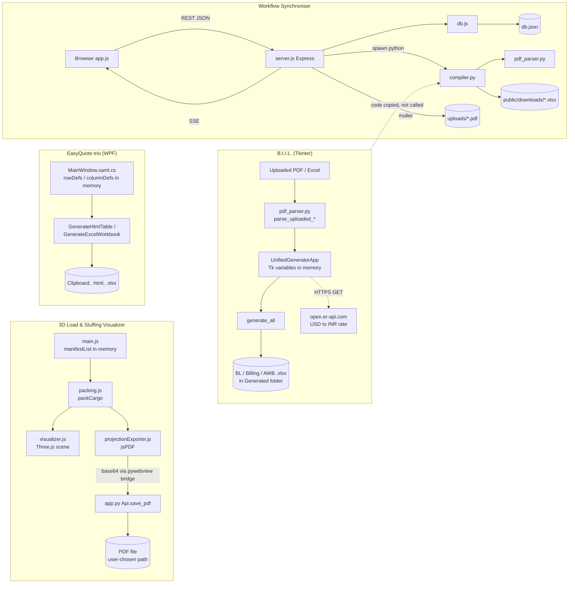

# Leadking Logistics Suite: Reverse-Engineering Report for Forensic Analytics Integration

**Scope:** static source analysis of the repository at `C:\Users\Jayaram\Desktop\Forensics`.
**Method:** every first-party source file was read; nothing in the repository was modified; no application was executed.
**Status labels:** CONFIRMED (read in code), DOCUMENTED (README only), INFERRED, NOT FOUND, NOT VERIFIED.

**Inspection coverage**

| Area | Coverage |
|---|---|
| `Workflow syncroniser/` — `server.js`, `db.js`, `compiler.py`, `pdf_parser.py`, `public/js/app.js`, `db.json`, `package.json` | Read in full |
| `B,I,I,L/` — `unified_generator.py` | Lines 1–430, 700–760, 860–2050, 2342–2590, 2760–2857 read; the remaining UI-building code and the three client-specific BL generators (2048–2340) were outlined only (their logic was read in the near-identical `compiler.py` copies) |
| `B,I,I,L/` — `document_generator.py` | Lines 83–160, 618–700, 821–1076 read; rest outlined by symbol |
| `B,I,I,L/` — `pdf_parser.py`, `build_unified.py`, `scratch/test_cotton.py` | Read in full (parser via diff against the synchroniser copy) |
| `3D_stuffing_visualizer/` — `app.py`, `src/main.js`, `src/packing.js`, `src/projectionExporter.js`, `package.json`, `vite.config.js` | Read in full |
| `3D_stuffing_visualizer/src/visualizer.js` | Outline plus lines 221–300 |
| `EasyQuote/MainWindow.xaml.cs` | Lines 1–190 and 425–1138 read; 190–425 (grid construction) checked by search |
| `EasyQuote/EasyQuoteImport/`, `EasyQuote/StuffingReport/` | Diffed / outlined against `EasyQuote`; model and export handlers read |
| `public/index.html`, CSS, XAML layout, Excel/PDF template files, `node_modules`, `dist` | Not read (searched only). **Template and sample document contents were deliberately not opened** |

Not executed: no tests, builds, servers or parsers were run. Every behavioural statement below is derived from reading code.

---

# PART I — EXECUTIVE SUMMARY

### 1. What the repository contains

Four independent components, not three. The fourth, the **Workflow Synchroniser**, is the most important one for a forensic project and was not in the expected scope.

| # | Component | What it really is |
|---|---|---|
| 1 | **3D Load & Stuffing Visualizer** | Browser app (vanilla JavaScript + Three.js, bundled by Vite) inside a Python `pywebview` desktop window. Packs cargo into a container, renders it, exports a one-page PDF. |
| 2 | **EasyQuote** | Three separate C#/WPF programs sharing one design: `EasyQuote` (export local charges quote), `EasyQuoteImport` (import charges quote), `StuffingReport` (stuffing report / vessel schedule e-mail composer). All are free-text grid editors that emit HTML, plain text or Excel. |
| 3 | **B.I.I.L.** | Two Python/Tkinter desktop programs: `document_generator.py` (older; fills Invoice, Packing List, BL Instruction, AWB Instruction templates from typed data) and `unified_generator.py` (newer; parses uploaded PDF/Excel documents, then fills BL Instruction, GST Billing Invoice and AWB Instruction workbooks). |
| 4 | **Workflow Synchroniser** | Node.js/Express LAN web application with a JSON-file database, login, shipment jobs, per-job workflow steps, a history log, PDF checklist parsing and Excel generation through a Python subprocess. |

### 2. Technologies (CONFIRMED from manifests and imports)

- JavaScript ES modules, `three` ^0.184.0, `jspdf` ^4.2.1, Vite ^8.0.12; Python `pywebview`, `http.server` (`3D_stuffing_visualizer/package.json`, `app.py`).
- C# on `net10.0-windows`, WPF, `ClosedXML` 0.105.0 (three `.csproj` files).
- Python 3, Tkinter, `openpyxl`, `pdfplumber`, `xlrd` (lazy import), `urllib`; PyInstaller build script (`build_unified.py`).
- Node.js, `express` ^4.19.2, `multer`, `cors`, `bcryptjs`; Server-Sent Events; Python subprocess (`Workflow syncroniser/package.json`, `server.js`).

README inaccuracies (DOCUMENTED but contradicted by code): the visualizer is not React; B.I.I.L. does not import Pandas (the build script explicitly excludes it) and is a GUI, not a command-line tool; EasyQuote has no auto-save; `xlsx` and `html2canvas` are declared dependencies of the visualizer but are never imported in `src/`.

### 3. How the applications relate

- **No runtime integration between the visualizer, EasyQuote and B.I.I.L.** No shared database, file, API, IPC or identifier. CONFIRMED by the absence of any import, network call or file read linking them.
- **The Workflow Synchroniser reuses B.I.I.L. logic by copy, not by call.** `Workflow syncroniser/compiler.py` contains BL/AWB/billing generators labelled "copied/adapted from unified_generator.py", and `Workflow syncroniser/pdf_parser.py` is a superset of `B,I,I,L/pdf_parser.py` (adds MAWB, HAWB, chargeable weight, AD code, GSTN extraction). `Workflow syncroniser/BIIL/` is a byte-identical copy of the four B.I.I.L. Python files and is **not** invoked by the server.
- Applications share **business concepts** only: container number, seal number, shipping bill number, invoice number, gross/net weight, package count, CBM.

### 4. Inputs, transformations, outputs

| Component | Accepts | Transforms | Produces |
|---|---|---|---|
| Visualizer | Typed cargo dimensions, weight, quantity, type; container choice | Extreme-point 3D bin packing with overlap, support and payload checks | On-screen 3D view, utilisation figures, PDF report |
| EasyQuote trio | Typed text in a grid | None beyond formatting; **no arithmetic at all** | Clipboard HTML/text, `.html` file, `.xlsx` file |
| B.I.I.L. | Typed fields; uploaded checklist PDF, invoice/packing list PDF or Excel | Regex/keyword extraction; totals; GST and TDS arithmetic; USD→INR conversion | `.xlsx` workbooks in a chosen folder |
| Synchroniser | Typed job form; uploaded checklist PDF; workflow tick boxes; closing bill details | Same extraction; job/step state machine; GST arithmetic | `db.json` records, `.xlsx` downloads, SSE broadcasts |

### 5. Logging, persistence, timestamps, history

| Capability | Visualizer | EasyQuote trio | B.I.I.L. | Synchroniser |
|---|---|---|---|---|
| Persistent business data | None | None (exports only) | None (exports only) | `db.json` |
| User identity | None | None | None | Login exists; identity on writes is a client-supplied display name |
| Timestamps stored | None | None (date is a typed text field) | None | `created_at`, `updated_at` (server clock, ISO-8601 UTC) |
| Action history | Console diagnostics only | Status bar text only | On-screen text box, cleared on each run | `history_logs` (message, user, time) |
| Old/new values | No | No | No | No |
| Stable identifiers | No | No | No | Integer `id`, unique `job_no` |

### 6. Most important findings for a forensic layer

1. **Only the Workflow Synchroniser has anything resembling evidence**, and it is the natural anchor for the project: it already has job identifiers, users, timestamps, a history table and a single choke-point data layer (`db.js`).
2. **The existing history log is not a forensic audit trail.** Entries are free-text messages without field names or before/after values; they are deleted along with the job (`deleteJob`, `db.js:831-841`); the whole file is rewritten on each save.
3. **Actor identity is not trustworthy as built.** Mutating endpoints take `user`/`creator` from the request body with no session or token check (`server.js:239-383`); the admin check compares a caller-supplied string to `'admin'` (`server.js:45-52`).
4. **Edits destroy prior state.** `updateJob` replaces all cargo, container and charge rows and overwrites the generated spreadsheets under deterministic filenames (`db.js:627-676`, `compiler.py:619-664`).
5. **The three desktop tools are stateless.** Any forensic event from them must be created by new instrumentation; nothing can be recovered retrospectively except the exported files themselves.
6. **There is no shared shipment identifier.** Only the synchroniser has `job_no`. B.I.I.L. has an optional job number field; the visualizer and EasyQuote have none.
7. **Tax logic differs between copies of the same billing code** (flat 9%+9% in `compiler.py:467-471` versus per-row editable rates with 2.5% for ocean freight in `unified_generator.py:870-880, 1784-1829`). This is a ready-made cross-document consistency test.

### 7. Readiness assessment

**Confirmed limitations:** no audit trail with field-level deltas; no tamper protection; no versioning of generated documents; no persistence in three of four components; no cross-application identifier; unauthenticated write API; no automated tests.

**Unverified:** runtime behaviour of every component (nothing was executed); PDF extraction accuracy on real documents; contents and cell layout of the Excel templates; whether the WPF projects build on the available SDK; whether `/uploads` files are reachable from the browser (see §3.8-D).

**Overall:** low readiness as-is, but the synchroniser's architecture makes a first working forensic prototype inexpensive, because nine exported functions in one file mediate every state change.

---

# PART II — REPOSITORY STRUCTURE AND ARCHITECTURE

## 2.1 Repository Inventory

| Application or Module | File/Folder Path | Technology | Main Responsibility | Entry Point | Status |
|---|---|---|---|---|---|
| Visualizer desktop wrapper | `3D_stuffing_visualizer/app.py` | Python, pywebview, http.server | Serve `dist/` on port 24689, open native window, save PDF via OS dialog, print JS logs | `if __name__ == '__main__'` (76–115) | Confirmed |
| Visualizer UI/controller | `3D_stuffing_visualizer/src/main.js` | JavaScript | Manifest state, forms, unit conversion, pallet/barrel helpers, orchestration | `DOMContentLoaded` handler (31–46) | Confirmed |
| Packing engine | `3D_stuffing_visualizer/src/packing.js` | JavaScript (no dependencies) | `packCargo` bin-packing algorithm | Called from `calculateStuffing` | Confirmed |
| 3D renderer | `3D_stuffing_visualizer/src/visualizer.js` | Three.js | Scene, meshes, cosmetic bag compression, snapshot | `initVisualizer` | Confirmed (partly read) |
| PDF report | `3D_stuffing_visualizer/src/projectionExporter.js` | jsPDF | `exportStuffingReport` | Export button | Confirmed |
| Vite scaffold leftover | `3D_stuffing_visualizer/src/counter.js` | JavaScript | Unused template file | — | Dead code |
| EasyQuote (export) | `EasyQuote/MainWindow.xaml(.cs)`, `EasyQuote.csproj` | C#, WPF, ClosedXML | Charge grid editor and exporter | `App.xaml` → `MainWindow()` | Confirmed; not built |
| EasyQuote (import) | `EasyQuote/EasyQuoteImport/` | C#, WPF, ClosedXML | Same program with import charge defaults and 3 columns | `MainWindow()` | Confirmed; not built |
| Stuffing report composer | `EasyQuote/StuffingReport/` | C#, WPF, ClosedXML | Two-column shipment/vessel key-value report | `MainWindow()` | Confirmed; not built |
| B.I.I.L. unified generator | `B,I,I,L/unified_generator.py` | Python, Tkinter, openpyxl | Parse uploads, edit, generate BL / Billing / AWB | `UnifiedGeneratorApp().mainloop()` (2855–2857) | Confirmed |
| B.I.I.L. legacy generator | `B,I,I,L/document_generator.py` | Python, Tkinter, openpyxl | Generate Invoice / Packing List / BL / AWB from typed data | `LogisticsApp` | Confirmed; contains a hard-coded developer path (137) |
| PDF parser | `B,I,I,L/pdf_parser.py` | Python, pdfplumber | Checklist and invoice/packing-list extraction | `parse_pdf` | Confirmed |
| B.I.I.L. build script | `B,I,I,L/build_unified.py` | Python, PyInstaller | Build `LogisticsBillingSuite.exe`; kills running instances with `taskkill` | `build()` | Confirmed; **do not run casually** |
| B.I.I.L. scratch test | `B,I,I,L/scratch/test_cotton.py` | Python | Manual smoke script with hard-coded foreign paths | `test_cotton_generation` | Not runnable here as written |
| Synchroniser server | `Workflow syncroniser/server.js` | Node, Express | REST API, SSE, upload, subprocess orchestration | `app.listen` (399) | Confirmed |
| Synchroniser data layer | `Workflow syncroniser/db.js` | Node | In-memory tables persisted to `db.json` | Imported by `server.js` | Confirmed |
| Synchroniser compiler | `Workflow syncroniser/compiler.py` | Python, openpyxl | `parse` and `compile` CLI modes | `main()` (565–679) | Confirmed |
| Synchroniser parser | `Workflow syncroniser/pdf_parser.py` | Python, pdfplumber | Extended checklist parser | `parse_pdf` | Confirmed |
| Synchroniser client | `Workflow syncroniser/public/js/app.js`, `index.html` | Browser JavaScript | Single-page UI | `DOMContentLoaded` (108–120) | Confirmed |
| Duplicate B.I.I.L. copy | `Workflow syncroniser/BIIL/` | Python | Byte-identical copy; not referenced by server | — | Confirmed duplicate |
| Templates and samples | `B,I,I,L/Templates/`, `Workflow syncroniser/Templates/`, `Workflow syncroniser/air/`, root `.xlsx/.xls/.xlt` | Excel, PDF | Output templates and sample client documents | — | Present; contents not inspected |

**Missing from the upload** (referenced but absent): `EasyQuote.sln` (README; git-ignored); `B,I,I,L/Billing/Billing_Invoice.xlsx` (the generator falls back to building the invoice from scratch, `unified_generator.py:2442-2453`); `uploads/` and `public/downloads/` in the synchroniser (git-ignored runtime folders); any `requirements.txt` for the Python parts.

## 2.2 Project Structure

```
Forensics/
├── README.md, .gitignore
├── 3D_stuffing_visualizer/      app.py · index.html · src/{main,packing,visualizer,projectionExporter}.js · dist/ (prebuilt)
├── B,I,I,L/                     unified_generator.py · document_generator.py · pdf_parser.py · build_unified.py · templates · Templates/ · scratch/
├── EasyQuote/                   EasyQuote.csproj + MainWindow.* · EasyQuoteImport/ · StuffingReport/
└── Workflow syncroniser/        server.js · db.js · db.json · compiler.py · pdf_parser.py · public/ · Templates/ · BIIL/ (duplicate) · air/
```

- **Business logic:** `packing.js`; `unified_generator.py` (`recalculate_billing`, generators); `compiler.py`; `db.js`.
- **UI:** `main.js` + `index.html`; the three `MainWindow.xaml.cs`; Tkinter tab builders; `public/js/app.js`.
- **Shared utilities:** none across applications. `num_to_words`, `write_address_block`, `clean_weight` and the BL generators are duplicated in `unified_generator.py` and `compiler.py`.
- **Configuration:** essentially none. Port 24689 (`app.py:8`), `PORT` env var or 3000 (`server.js:26`), tax rates and default charges are literals in code.
- **Tests:** no automated test suite anywhere. `scratch/test_cotton.py` is a manual script.

## 2.3 Startup and Execution

| Application | Start command | Sequence |
|---|---|---|
| Visualizer | `npm run build` then `python app.py` (or `npm run dev` in a browser) | `app.py` checks `dist/` → HTTP server thread on 24689 → `webview.create_window(url=localhost:24689/?t=<epoch>, js_api=Api())` → page loads → `initVisualizer` → `renderContainersGrid` → `renderManifestTable` → `bindEventListeners` → `calculateStuffing` (`main.js:31-46`). Runs without Python too; the PDF then downloads through the browser. |
| EasyQuote trio | Build each `.csproj` in Visual Studio / `dotnet` | `MainWindow()` → `InitializeComponent` → `InitializeData` → `BuildGridWorkspace` → `UpdatePreview`. Three independent executables. |
| B.I.I.L. | `python unified_generator.py` or the PyInstaller exe | `__init__` → `init_variables` → `create_widgets` → `load_defaults` → `recalculate_totals` → background thread `fetch_live_exchange_rate` (`unified_generator.py:315-321`). |
| Synchroniser | `node server.js` (needs `python` on PATH with `openpyxl`, `pdfplumber`) | `db.js` loads/migrates `db.json` at import time (188–335) → Express middleware → routes → `listen(0.0.0.0)`; browser loads `index.html` → `checkLoginSession` → `initEventListeners` → `setupSSE`. |

All four are operationally independent.

## 2.4 Architecture Diagram



Dotted lines: the exchange-rate call is a confirmed external request; the B.I.I.L.→synchroniser relation is source duplication only. There are no edges between VIS, EQ and the other subgraphs because none exist in code.

---

# PART III — APPLICATION-BY-APPLICATION REVERSE ENGINEERING

## 3A. Workflow Synchroniser

### 3A.1 Purpose and capabilities (CONFIRMED)

A LAN dashboard where desk users create shipment "jobs", tick off a fixed workflow, and download generated BL/AWB instruction and billing spreadsheets.

- Four workspaces: `sea_export`, `sea_import`, `air_export`, `air_import` (`app.js:10`). Each has a fixed step list (`db.js:116-185`): 19 steps for sea export, 13 air export, 12 sea import, 10 air import.
- Job create/edit with ~38 header fields plus three child grids: cargo items, containers, billing charges.
- Checklist PDF upload pre-fills the form.
- Each step can be `Pending`, `Completed` or `N/A`. Ticking "Job Closed" opens a modal requiring closing bill number, amount, SGST and CGST (`app.js:1662-1675`, `711-755`).
- Admin-only views: activity log, per-desk counts, user management.
- A manual "flag" with remarks marks a delayed shipment (`is_flagged`, `flag_remarks`).

README's "AI/PDF data extraction" is regular-expression extraction; there is no model.

### 3A.2 Entry point and call flow

```
Browser form submit → handleFormSubmit (app.js:2025)
  → POST /api/jobs (server.js:239)
      → runExcelCompiler({info}) → spawn python compiler.py compile <downloads> (stdin JSON)   (server.js:127)
           → compiler.main → choose template by shipper name → generate_bl_* / generate_awb_instructions
           → generate_billing_invoice → print JSON {bl_file, billing_file}
      → mapCompileResult → info.download_urls                                                  (server.js:54)
      → createJob({info, creator})                                                             (db.js:378)
           → push job, cargo_items, containers, billing_charges, documents, workflow_steps, history_logs → saveToDisk
      → broadcast('job_created'), broadcast('log_entry')                                       (server.js:261)
```

A compile failure is caught and only written to the server console; the job is still saved (`server.js:247-255`).

### 3A.3 Inputs

| Input | Enters via | Stored | Validation |
|---|---|---|---|
| Username/password | `POST /api/login` | Not stored server-side; client keeps `{username,name,role}` in `localStorage` (`app.js:446`) | bcrypt over SHA-256 (`db.js:79-89`) |
| Job header fields | `handleFormSubmit` → `info` | `data.jobs[]` | Server requires only `job_no`; uniqueness is case-insensitive (`db.js:383`). All other fields default to `''` |
| Cargo rows | grid | `data.cargo_items[]` | `parseFloat(...) || 0`; `amount = qty × rate` computed in the browser (`app.js:2101`) and trusted by the server |
| Container rows | grid | `data.containers[]` | Rows without a container number are dropped client-side; no check of the ISO 6346 format or check digit |
| Billing charges | grid | `data.billing_charges[]` | Rows with empty description or amount ≤ 0 dropped client-side (`app.js:2124`) |
| Checklist PDF | `POST /api/parse-checklist` (multer) | `uploads/checklist-<epoch-ms>.<ext>` | None: any file type accepted |
| Step status | `PUT /api/jobs/:id/workflow/:stepId` | `workflow_steps[].status/updated_by/updated_at` | `status` and `user` must be non-empty; `status` value is not restricted to the three known values |
| Closing details | same endpoint, `closingDetails` | `jobs[].closing_bill_no/amount/sgst/cgst` | Parsed to numbers client-side; not compared to anything |
| Actor name | `creator` / `user` in request body | `history_logs[].user`, `updated_by` | **None. Whatever string the client sends is recorded.** |

Automatically derived values after a successful PDF parse: `notify` and `also_notify` default to "SAME AS CONSIGNEE"; `country_of_origin` to "INDIA"; three **hard-coded placeholder charges** (ocean: 120000 / 9500 / 4500; air: 85000 / 6500 / 3500) are inserted into the billing grid (`app.js:851-867`).

### 3A.4 Data structures (`db.json`; plain arrays, not a relational database)

| Table | Fields | Notes |
|---|---|---|
| `jobs` | `id`, `job_no`, `type`, `sb_no_date`, `invoice_no_date`, `buyer_order_no_date`, `file_ref_no`, `pre_carriage`, `place_of_receipt`, `vessel_voyage`, `carrier`, `port_of_loading`, `port_of_discharge`, `final_destination`, `country_of_origin`, `country_of_dest`, `hs_code`, `payment_mode`, `eta`, `etd`, `shipper`, `consignee`, `notify`, `also_notify`, `cha`, `forwarding_agent`, `buyer_if_other`, `cargo_desc`, `marks_nos`, `dimensions`, `total_pkgs`, `gross_weight`, `net_weight`, `cbm`, `type_of_packing`, `exchange_rate`, `bank_ac_drawback`, `mawb_no_date`, `hawb_no_date`, `chargeable_weight`, `status`, `closing_bill_no`, `closing_bill_amount`, `closing_sgst`, `closing_cgst`, `is_flagged`, `flag_remarks`, `created_at`, `updated_at` | Weights and package counts are **strings with units** ("20200 KGS", "1600 PP BAGS"). Number and date are combined in one string ("2421435 DT. 16/04/2026") |
| `cargo_items` | `id`, `job_id`, `sl_no`, `description`, `hs_code`, `qty`, `rate`, `unit`, `net_wt`, `gross_wt`, `amount` | numeric |
| `containers` | `id`, `job_id`, `sl_no`, `container_no`, `seal_no`, `pkgs` (string), `net_wt`, `gross_wt`, `cbm` | |
| `billing_charges` | `id`, `job_id`, `description`, `amount` | no tax rate stored |
| `documents` | `id`, `job_id`, `name`, `status` (`Pending`/`Submitted`), `updated_by`, `updated_at`, `download_url` | |
| `workflow_steps` | `id`, `job_id`, `name`, `status`, `updated_by`, `updated_at` | |
| `history_logs` | `id`, `job_id`, `message`, `user`, `created_at` | free text |
| `users` | `username`, `name`, `role`, `passwordHash` | |

The shipped `db.json` is empty (all arrays `[]`).

### 3A.5 Business logic

- **Identifiers:** `getNextId` returns `max(id)+1` (`db.js:34-38`). After the highest record is deleted, its id is reused.
- **Job status:** `Active` → `Closed` when the "Job Closed" step is `Completed`; back to `Active` when unticked, at which point the four closing fields are **blanked** (`db.js:880-892`). A second path sets `Completed` when every document is `Submitted` (`toggleDocumentStatus`, `db.js:768-798`); no UI call site for `toggleDocument` was found in `app.js` (NOT VERIFIED in `index.html`), so that path may be dormant.
- **Auto-completion:** steps "Prepared Checklist"/"Checklist Approval" complete when a checklist URL exists; "BL Instruction & Bill Generated"/"AWB Instruction" complete when the compile succeeded (`db.js:530-542`, `692-710`).
- **No ordering constraint:** any step can be completed, reverted or set N/A in any order by any user.
- **Edit semantics:** `updateJob` overwrites every header field (blank input erases the stored value), deletes and re-inserts all child rows with new ids, and appends the fixed message "Shipment details updated." (`db.js:570-724`). `type` is not changed by an edit.
- **Template selection:** substring match on shipper name — "COTTON HOME", "PEMI", "SAKTHI" — otherwise the standard template; `air_export` uses the AWB template (`compiler.py:595-617`).
- **Billing arithmetic** (`compiler.py:462-471`): taxable = Σ amount; CGST = SGST = 9% of taxable; grand total = taxable + CGST + SGST; TDS = 2% of taxable; payable = grand total − TDS. The browser shows the same 9%/9% figures without TDS (`app.js:1470-1477`).
- **Output filenames** (`compiler.py:619-664`): `Generated_BL_Instructions_<inv>.xlsx` (or client-prefixed), `Generated_AWB_Instructions_<inv>.xlsx`, `<SHIPPER>_JOB_NO_<jobno>.xlsx`, where `<inv>` is the alphanumeric part of the invoice string before "DT". Deterministic, so regeneration overwrites.
- **PDF extraction** (`pdf_parser.py`): text containing "CHECK LIST" routes to `parse_checklist`, otherwise `parse_invoice_packing_list`. Checklist parsing crops the first page into halves for exporter/consignee, then applies about 20 regular expressions. Container numbers are any `[A-Z]{4}\d{7}` token in the **file name or** text (236–249). Total net/gross weight is assigned to the first container only (260–270).

### 3A.6 Outputs and side effects

| Output | Where | Persistent |
|---|---|---|
| `db.json` (whole-file rewrite through `db.json.tmp` + rename) | `saveToDisk`, `db.js:23-31` | Yes; mutable; no backup or version |
| Uploaded PDFs | `uploads/checklist-<ms>.<ext>` | Yes; never deleted, never linked to a job id |
| Generated workbooks | `public/downloads/` | Yes; overwritten on regenerate |
| SSE events `job_created`, `job_updated`, `job_deleted`, `document_toggled`, `workflow_toggled`, `log_entry` | `broadcast`, `server.js:86-95` | No (in-flight only) |
| Console output | `console.log/error` | Only if the operator redirects stdout |
| Browser `localStorage`: `currentUser`, `currentWorkspace`, `theme` | `app.js` | Per browser |

### 3A.7 Error handling and validation gaps (each CONFIRMED from code unless marked)

- **A. Write endpoints do not authenticate the caller.** `POST/PUT/DELETE /api/jobs*` and the workflow/document endpoints have no middleware; the UI merely hides the delete button for non-admins (`app.js:976-981`).
- **B. `requireAdmin` trusts a caller-supplied value** (`adminUsername` query/body/header equal to `'admin'`).
- **C. Seeded accounts use the username as the password** (`db.js:206-212`); the login error text says so (`index.html:42`). Seeding only happens when `db.json` exists with an empty `users` array; if the file is absent on first start, an empty database is written and no users are seeded until the next start (`db.js:188-335`).
- **D. `/uploads` is not served.** Only `public/` is static (`server.js:30`), so the stored `checklist_pdf_url` falls through to the catch-all route and returns `index.html` (INFERRED; needs a runtime check). Also, multer's function-style `destination` does not create the folder, so uploads fail until `uploads/` exists (INFERRED from multer's documented behaviour).
- **E. Deleting a job deletes its history** (`db.js:837`), and the SSE log line for deletion carries no actor.
- **F. Compiler failure is silent to the user**; the job is saved without download links.
- **G. Rendering uses `innerHTML` with unescaped stored values** (for example `app.js:984-988`, `1411-1420`). A stored value containing markup would be interpreted by every viewer's browser (INFERRED; not executed).
- **H. Concurrency:** single-process, synchronous writes; two simultaneous edits of one job resolve as last-write-wins with no conflict detection.
- **I. `getAllHistoryLogs` returns only the latest 200 entries** (`db.js:819`).
- **J. Live log entries in the browser carry a client-generated timestamp and a user parsed out of the message text** (`app.js:386-392`), so the on-screen log is not the stored log.

### 3A.8 Testing

No tests. Nothing verified by execution.

---

## 3B. B.I.I.L.

### 3B.1 Purpose and capabilities

The expansion of "B.I.I.L." is **NOT FOUND** anywhere in code or documentation. Window titles are "Unified Logistics & Billing Suite" and "Logistics Document Generator".

| Program | Inputs | Outputs |
|---|---|---|
| `unified_generator.py` | Checklist PDF; invoice `.xlsx/.xls/.pdf`; packing list `.xlsx/.xls/.pdf`; typed edits | BL Instruction (4 templates), Billing/GST Invoice, AWB Instruction |
| `document_generator.py` | Typed data only | `Generated_Invoice.xlsx`, `Generated_Packinglist.xlsx`, `Generated_BL_Instructions.xlsx`, `Generated_AWB_Instructions.xlsx` |

The unified program does **not** generate commercial invoices or packing lists; the legacy one does not parse anything. Only the unified program is built into an executable.

### 3B.2 Call flow (unified)

```
upload_checklist / upload_invoice / upload_packing_list         (1355 / 1314 / 1586)
   → pdf_parser.parse_pdf  or  parse_uploaded_invoice / parse_uploaded_packing_list   (1393 / 1627)
   → apply_parsed_data (1190)  → sync_billing_metadata (1250)
user edits Tk fields; charge rows → on_charge_desc_change (870) → recalculate_billing (1784)
"Generate Documents" → generate_all (1873)
   → recalculate_totals, recalculate_billing → get_data_payload (1859)
   → generate_bl_instructions_file (2024) → one of four template writers
   → generate_billing_invoice_file (2442) or _scratch (2553)
   → generate_awb_instructions_file (2777)
   → wb.save(out_path)
```

### 3B.3 Inputs and validation

- About 37 general fields in `self.inputs` (`init_variables`, 323–346) and 17 billing metadata fields in `self.billing_vars`.
- **The application starts pre-filled with a complete sample shipment** (`load_defaults`, 1107–1188): shipper, consignee, four container/seal numbers, job number, MBL, fifteen default charges (`DEFAULT_CHARGES`, 226–242). If the user generates without replacing a field, the sample value goes into the document.
- Excel invoice parsing reads fixed cells (B3:B6 shipper, B8:B13 consignee, G3/H3 invoice number, B17 vessel, …) with keyword-search fallbacks (`find_value_by_keywords`, 133–158).
- Packing-list parsing scans every cell of every sheet for `[A-Z]{4}\d{7}` and assumes the next five cells are seal, packages, net, gross, CBM (1634–1681).
- Numeric parsing everywhere uses `try/except` that substitutes 0; no warning is shown for unparsable input.
- External value: on startup a background thread requests `https://open.er-api.com/v6/latest/USD` and writes the INR rate into the ocean-freight converter field (1846–1857). Failures are swallowed.

### 3B.4 Data structures

No model classes. State lives in Tk `StringVar`/`DoubleVar` objects and two lists of dictionaries:

- `container_rows[]`: `c_no_var`, `s_no_var`, `pkgs_var`, `net_ent`, `gross_ent`, `cbm_ent`.
- `charge_rows[]`: `desc_var`, `amount_ent`, `cgst_rate_ent`, `sgst_rate_ent`, computed `cgst_amt_var`, `sgst_amt_var`, `total_var`.
- Parsed data is a plain `dict` with keys such as `shipper`, `consignee`, `job_no`, `file_ref_no`, `sb_no_date`, `invoice_no_date`, `port_of_discharge`, `final_destination`, `net_weight`, `gross_weight`, `total_pkgs`, `cargo_items[]`, `containers[]`, `package_from`, `package_to`.

### 3B.5 Business logic

- **Billing** (`recalculate_billing`, 1784–1844): per row, CGST = amount × rate%, SGST likewise, each rounded to 2 decimals; totals are sums; TDS = 2% of taxable; payable = grand total − TDS.
- **Rate rule** (`on_charge_desc_change`, 870–880): on every keystroke in a description, the rates are reset to 2.5% if the text starts with "o/f", "of ", "of-" or contains "ocean freight", else 9%. A manually typed rate is therefore overwritten the next time the description is edited.
- **Currency** (`update_ocean_freight_from_usd`, 882–922): INR = USD × exchange rate; rewrites the O/F row's amount and description, and any "fuel surcharge USD n" row.
- **Container totals** (`recalculate_totals`, 1745–1782): sums are displayed only. **There is no check that container sums equal the header gross/net weight or package count.**
- **Template auto-selection** by shipper substring (1236–1248), user-overridable.
- **Filenames** (1929–1985) derive from invoice number, shipper, job number, package text and container count.
- **Amount in words** (`num_to_words`) handles values below 100,000 only; larger values print digits.

### 3B.6 Outputs and side effects

- `.xlsx` files written with `wb.save` into `<app dir>/Generated` by default (285–287) or a chosen folder. Existing files are overwritten silently.
- One outbound HTTPS request per launch (exchange rate).
- An on-screen "Generation Progress Log" (`log_to_box`, 1739–1743) that is **cleared at the start of each generation** (1884) and never written to disk.
- `build_unified.py` runs `taskkill /F` on two executable names and deletes `build/`, `dist/` and the `.spec` file. It is a build tool; it should not be run during analysis.

### 3B.7 Error handling

Generators are wrapped per document in `try/except` that prints the exception text into the on-screen log; a failed document does not stop the others. Spreadsheet parse failures show a message box. PDF parse failures are logged to the on-screen box only.

### 3B.8 Testing

`scratch/test_cotton.py` instantiates the Tk app and runs one checklist through one template, with absolute paths under `c:\Users\vkmsd\...`. It contains no assertions beyond "file exists". Not run.

---

## 3C. 3D Load & Stuffing Visualizer

### 3C.1 Purpose and capabilities (CONFIRMED)

- Cargo types: `carton`, `pallet` (optionally built from cartons), `bag` (FIBC with a bulging factor), `barrel` (drums on a pallet).
- Six predefined containers plus one custom container (`main.js:14-21`, `868-897`).
- Units cm / in / mm; internal storage is always centimetres.
- Packing with overlap, boundary, support-area and payload checks; step-by-step loading animation; PDF export.

README's "7% vertical bag compression" exists **only as a rendering effect** (`visualizer.js:281-285`); it does not change packing results or utilisation figures.

### 3C.2 Call flow

```
form submit (main.js:690) → unit conversion → type-specific derivation → addManifestItem (418)
   → renderManifestTable → calculateStuffing (339)
        → packCargo(selectedContainer, manifestList)   (packing.js:6)
        → renderContainer, renderCargo, statistics DOM update, renderLoadedList
export button (912) → exportStuffingReport (projectionExporter.js:26)
   → jsPDF → window.pywebview.api.save_pdf(filename, base64)  (app.py:45)  or browser download
```

`calculateStuffing` is the single recalculation choke point: it runs on add, edit, delete, clear, container change, unit change and the manual recalculate button.

### 3C.3 Inputs and validation

| Input | Handling |
|---|---|
| Name, L, W, H, weight, quantity, colour, orientation, type | `parseFloat`/`parseInt` with **no NaN, zero or negative checks** in JavaScript (`main.js:693-705`). HTML `required`/`min` attributes may exist in `index.html` (NOT VERIFIED). |
| Barrel | Diameter and height → pallet footprint `max(pallet, rows×dia)`, height + 14.4 cm, weight = rows×cols×drum weight + pallet tare (15 kg plastic / 30 kg wood); layout 2×2, 2×1 or 1×2 chosen with an 18 cm overhang tolerance (`main.js:717-766`) |
| Pallet with carton calculator | `pack2D` tries six guillotine layouts; layers = ⌊(max height − 14.4)/carton height⌋ (`main.js:1327-1573`) |
| Custom container | L, W, H, payload; replaces any previous custom container |

### 3C.4 Data structures

- `manifestList[]`: `{name, length, width, height, weight, quantity, color, orientation, type, sizeId, material, fillingMaterial, bulgingFactor, …pallet/barrel extras}`. **No id field.** Items are addressed by array index.
- `selectedContainer`: `{id, name, length, width, height, maxWeight, desc}`; ids `20std`, `40std`, `40hc`, `45hc`, `20ot`, `40ot`, `custom`.
- `packingResults`: `{placedBoxes[], unplacedBoxes[], totalWeight, totalVolume, weightUtilization, volumeUtilization, containerVol, containerMaxWeight}`.
- Placed box: manifest fields plus `id = "<typeIndex>-<itemIndex>"`, position `x,y,z`, oriented size `l,w,h`, `originalDim`.

The application starts with four sample manifest lines already loaded (`main.js:7-12`).

### 3C.5 Packing algorithm (`packCargo`, `packing.js`)

1. Expand each manifest line into `quantity` individual items. Bags are inflated: length and width × (1 + bulge%), height × (1 − 0.3 × bulge%) (lines 10–45).
2. Sort all items by volume, largest first (48–52).
3. Keep a list of candidate corners ("extreme points"), starting at the origin.
4. For each item:
   - If `currentWeight + item.weight > maxWeight`, mark it unplaced and continue (134–137). Lighter items later in the list can still be placed.
   - Build allowed orientations: one (`none`), two (`upright`), or up to six (`any`) (141–166).
   - For every corner × orientation: reject if outside the container (172), if it intersects a placed box (bucketed search, 177–198), or if less than 60% of its base rests on boxes whose tops are exactly at that height (`checkStability`, 98–126; floor is always stable).
   - Score = z×1,000,000 + x×1,000 + y; lowest wins, so loading proceeds floor-first, then from the back wall, then left to right (206).
   - Place the item, add three new corners, drop corners that are duplicates, outside the container or inside a box (236–296). Otherwise mark it unplaced (298–301).
5. Shift all boxes sideways so the load is centred across the container width (304–328).
6. Return volume utilisation = packed volume ÷ container volume and weight utilisation = loaded weight ÷ payload.

Consequences relevant to forensics:

- **Loaded weight can never exceed the payload**; an over-weight manifest shows up as unplaced items, not as an over-limit result.
- **The reason an item was not placed is not recorded** (payload versus space versus support).
- The algorithm is deterministic for a given input, so a result can be reproduced from the manifest and container alone.
- Not modelled: weight distribution along the length, floor loading, stacking strength, door-side accessibility.

### 3C.6 Outputs and side effects

- PDF `stuffing_report_<container name>.pdf` with utilisation summary, WebGL snapshot, up to ten manifest rows and an unplaced-item warning banner (`projectionExporter.js`). **The PDF contains no date, no author, no report number and no shipment reference.** Footer text: "Generated via Antigravity 3D Load & Stuffing Exporter."
- `app.py` prints forwarded browser console lines to stdout/stderr (`Api.log_message`, `Api.log_error`).
- No file is read or written other than the PDF. No network calls beyond `localhost`. No `localStorage`.

### 3C.7 Error handling

`calculateStuffing` wraps the calculation in `try/catch` and shows an alert. Export is blocked when nothing is placed. Invalid numbers propagate as `NaN` into the algorithm (comparisons with `NaN` are false, so such items would generally end up unplaced; INFERRED).

### 3C.8 Testing

None. `pack2D` is exported, apparently for testing, but no test imports it.

---

## 3D. EasyQuote, EasyQuoteImport, StuffingReport

### 3D.1 Purpose and capabilities (CONFIRMED)

All three are **text table composers**. They perform **no price calculation, no totals, no rate lookup and no validation**. Every cell is a string such as "Rs.9500/- per 20ft", "AT ACTUALS" or "Will advise".

| Program | Model | Defaults |
|---|---|---|
| `EasyQuote` | `ColumnDef {Header, IsEnabled, IsChennai}`, `RowDef {Header, IsEnabled, DefaultValues, CurrentValues}` (`MainWindow.xaml.cs:16-34`) | 6 columns (Chennai/Tuticorin × LCL/20ft/40ft), 11 export charge rows (46–93) |
| `EasyQuoteImport` | Same classes | 3 columns (40 FCL / 20FCL / LCL), 12 import charge rows |
| `StuffingReport` | `ReportRow {ShipmentKey, ShipmentValue, VesselKey, VesselValue, colour flags, IsEnabled}` | 12 rows: stuffing date, shipper, shipping bill number, packages, gross weight, container number, seal number, volume, feeder vessel, ETD/ETA, EGM number |

`StuffingReport` is unrelated to the 3D visualizer; it is a manually typed e-mail body.

### 3D.2 Call flow (EasyQuote)

```
any TextBox edit → OnDataChanged (518) → UpdatePreview (532) → GenerateHtmlTable (570) → WebBrowser preview
Add/Delete row or column → SaveCurrentValuesFromUI (99) → mutate lists → BuildGridWorkspace (142) → UpdatePreview
Copy HTML   → CopyHtmlBtn_Click (735)      → CF_HTML clipboard payload
Copy text   → CopyTextBtn_Click (796)
Save HTML   → SaveHtmlFileBtn_Click (813)  → File.WriteAllText
Export xlsx → ExportExcelBtn_Click (868)   → GenerateExcelWorkbook (919) → workbook.SaveAs
Reset       → ResetBtn_Click (1086)        → InitializeData
```

### 3D.3 Inputs

Header fields with literal XAML defaults (`MainWindow.xaml:197-227`): `ClientNameTxt` "Valued Customer", `QuoteRefTxt` "EQ/2026/0602", `QuoteDateTxt` "02-Jun-2026", `ValidityTxt` "Valid for 15 Days", `SubjectTxt`, `HeaderNoteTxt`. **The quote reference and date are fixed strings; the code never reads the system clock** (no `DateTime` usage) **and never generates a reference number.**

### 3D.4 Outputs

- Clipboard (HTML fragment and Unicode text).
- `Quotation_<client>.html` and `<quoteRef>_<client>.xlsx` through a save dialog; `Stuffing_Report_Schedule.xlsx` for the stuffing report.
- Disabled rows/columns are omitted from every output but remain in memory.
- Nothing is saved automatically and no file can be loaded back in. Closing the window loses the quotation.

### 3D.5 Error handling and testing

Each export handler has a `try/catch` that shows a message box. `HtmlEncode` escapes output (1128–1136). No tests. `bin/` folders are empty, so no build evidence exists in the upload.

---

# PART IV — END-TO-END DATA FLOW

## 4.1 Workflow Synchroniser: checklist → job → documents → closure

| Workflow Step | File and Function | Input | Transformation | Output | Persistent? |
|---|---|---|---|---|---|
| 1. Upload checklist | `app.js` `handleChecklistUpload`; `server.js` `/api/parse-checklist` | PDF file | Saved as `checklist-<ms>.pdf` | File path | Yes (file) |
| 2. Extract fields | `compiler.py parse` → `pdf_parser.parse_checklist` | PDF text | Regex extraction | JSON dict | No |
| 3. Autofill form | `handleChecklistUpload` 782–867 | JSON | Fills inputs; inserts placeholder charges | DOM state | No; **parsed values are not kept separately from later edits** |
| 4. User edits | browser | keystrokes | — | DOM state | No |
| 5. Submit | `handleFormSubmit` 2025–2160 | DOM | Builds `info`; `amount = qty × rate`; drops empty rows | JSON payload | No |
| 6. Generate workbooks | `runExcelCompiler` → `compiler.main` | `info` | Template fill; GST/TDS arithmetic | 2 `.xlsx` | Yes; overwritten on regenerate |
| 7. Store job | `db.createJob` | `info`, `creator` | Assign ids, timestamps, default docs and steps | Rows in 7 arrays | Yes (`db.json`) |
| 8. Log | `createJob` 555–561 | — | Fixed message | `history_logs` row | Yes, until job deletion |
| 9. Notify | `broadcast` | job | SSE | UI refresh | No |
| 10. Step toggles | `toggleWorkflowStep` | status, user | Update step; maybe change job status | Updated rows + log row | Yes; **previous status not kept** |
| 11. Closure | `handleClosureSubmit` → `toggleWorkflowStep` | bill no, amount, SGST, CGST | Stored on job | Job fields | Yes; blanked if reopened |

**Preservation:** the uploaded PDF and the final job row survive. The parser's raw output, every intermediate edit, and every earlier version of a regenerated workbook do not.

## 4.2 B.I.I.L. unified: documents → BL and billing workbooks

| Workflow Step | File and Function | Input | Transformation | Output | Persistent? |
|---|---|---|---|---|---|
| 1. Choose file | `upload_checklist` 1355 | path | — | `checklist_path_var` | No |
| 2. Parse | `pdf_parser.parse_pdf` | PDF | Regex | dict | No |
| 3. Apply | `apply_parsed_data` 1190 | dict | Overwrite fields; rebuild container rows; choose template | Tk vars | No |
| 4. Sync | `sync_billing_metadata` 1250 | Tk vars | Copy to billing metadata | Tk vars | No |
| 5. Edit charges | `add_charge_row`, `on_charge_desc_change`, `update_ocean_freight_from_usd` | keystrokes | Rate rule; currency conversion | Tk vars | No |
| 6. Compute | `recalculate_billing` 1784 | rows | GST, TDS, totals | Tk vars | No |
| 7. Generate | `generate_all` 1873 | all vars | Template fill | `.xlsx` files | Yes (files only) |
| 8. Log | `log_to_box` | — | Text | On-screen box | No |

**Preservation:** only the output workbooks. The source file path is not written into the output. The exchange rate used is embedded in the charge description text only if the converter was used.

## 4.3 Visualizer: manifest → packing → PDF

| Workflow Step | File and Function | Input | Transformation | Output | Persistent? |
|---|---|---|---|---|---|
| 1. Enter cargo | `main.js` submit handler 690 | form | Unit → cm; barrel/pallet derivation | manifest object | No |
| 2. Store | `addManifestItem` 418 | object | push | `manifestList` | No (memory) |
| 3. Pack | `packCargo` | container, manifest | §3C.5 | `packingResults` | No |
| 4. Render | `renderCargo` | placed boxes | Cosmetic compression | WebGL | No |
| 5. Statistics | `calculateStuffing` 369–404 | results | Formatting | DOM | No |
| 6. Export | `exportStuffingReport` | results, manifest | jsPDF layout | PDF bytes | — |
| 7. Save | `Api.save_pdf` (`app.py:45-73`) | base64 | decode, write | PDF file | Yes |

**Preservation:** only the PDF, which shows original (not bulged) dimensions, at most ten cargo types, and no coordinates. The exact placement cannot be recovered from the PDF, but it can be recomputed if the manifest and container are known.

## 4.4 EasyQuote: grid → quotation

| Workflow Step | File and Function | Input | Transformation | Output | Persistent? |
|---|---|---|---|---|---|
| 1. Edit cells | TextBox `TextChanged` (296, 352, 422) | text | none | `rowDefs`/`columnDefs`/TextBoxes | No |
| 2. Preview | `UpdatePreview` → `GenerateHtmlTable` | model | HTML string | WebBrowser | No |
| 3. Export | `ExportExcelBtn_Click` → `GenerateExcelWorkbook` | model | ClosedXML styling | `.xlsx` | Yes (file) |
| 4. Copy | `CopyHtmlBtn_Click` | model | CF_HTML header | Clipboard | No |

**Preservation:** exported file only. `DefaultValues` is kept in memory beside `CurrentValues`, so a default-versus-current comparison is technically available at export time.

## 4.5 Cross-application relationships

| Question | Answer | Evidence |
|---|---|---|
| Can a visualizer output be imported by B.I.I.L. or EasyQuote? | No | Visualizer emits PDF only; neither target reads that layout; no import code exists in EasyQuote at all |
| Can an EasyQuote quotation feed billing? | No | No reader for EasyQuote `.xlsx`; billing charges are typed or defaulted |
| Can B.I.I.L. outputs feed the synchroniser? | No direct path | The synchroniser parses checklist/invoice PDFs, not B.I.I.L. workbooks |
| Do B.I.I.L. and the synchroniser accept the same source documents? | Yes | Both call `parse_pdf` on checklist PDFs; field names in the returned dict are identical |
| Is there a shared key? | Only by coincidence of typed values | `job_no`, `invoice_no_date`, `sb_no_date`, `container_no` are free text in each tool |

---

# PART V — FORENSIC READINESS AUDIT

## 5.1 Existing logging

| Mechanism | Records | When | Stored | Time | User | Old/new | Survives restart | Alterable |
|---|---|---|---|---|---|---|---|---|
| Synchroniser `history_logs` (`db.js`) | Fixed-template message per create, update, step or document change, automatic status change | Inside each mutating function | `db.json` | Server ISO time | Client-supplied display name or "System" | No (new status appears inside the message text; old status never) | Yes | Yes: plain JSON; removed on job delete |
| Synchroniser `workflow_steps.updated_by/updated_at` | Last change only | On toggle | `db.json` | Yes | As above | No | Yes | Overwritten by the next toggle |
| Synchroniser SSE `log_entry` | One-line message | After each write | Not stored | Client clock on receipt | Parsed from text | No | No | — |
| Synchroniser server console | Start banner, compile and broadcast errors | — | stdout | No | No | No | No | — |
| Visualizer `console.log` bridge (`index.html:8-42`, `app.py:36-42`) | Seven diagnostic lines per calculation: manifest length, container name, placed count | Each `calculateStuffing` | `window.my_logs` array and Python stdout | No | No | No | No | — |
| B.I.I.L. `log_to_box` | Upload file names, template choice, per-document success/failure | During upload and generation | Tk text widget | No | No | No | No (cleared per run) | — |
| EasyQuote `StatusTxt` | Last action sentence | After each action | Status bar | No | No | No | No | — |

No structured logging library is used anywhere. None of the above is a forensic audit record; `history_logs` is the closest and is best described as an activity feed.

## 5.2 Persistence and history

| Item | Visualizer | EasyQuote | B.I.I.L. | Synchroniser |
|---|---|---|---|---|
| Shipment records | — | — | — | `jobs` |
| Cargo records | memory | — | memory | `cargo_items`, `containers` |
| Quotation records | — | memory | — | — |
| Billing lines | — | — | memory | `billing_charges` |
| Document metadata | — | — | — | `documents` (name, status, URL) |
| Previous versions | No | No | No | No |
| Modification history | No | No | No | Message-level only |
| User identities | No | No | No | `users`; not bound to requests |
| Timestamps | No | No | No | Yes |
| Stable identifiers | No | No | No | Mostly (id reuse possible) |

## 5.3 Identifiers and correlation

| Identifier | Where | Generation | Format | Reliability |
|---|---|---|---|---|
| `jobs.id` | synchroniser | `max+1` | integer | Can be reused after deleting the newest job |
| `job_no` | synchroniser; B.I.I.L. `billing_vars["JOB NO:"]` | Typed, or parsed from "Job No & Date:" | free text (sample default "2606SX124") | Unique (case-insensitive) in the synchroniser only; editable afterwards |
| `file_ref_no` | synchroniser, B.I.I.L. | Typed/parsed | free text | — |
| `invoice_no_date`, `sb_no_date`, `mawb_no_date`, `hawb_no_date` | synchroniser, B.I.I.L. | Typed/parsed | "<number> DT. <date>" in one string | Needs parsing; date formats vary (`dd/mm/yyyy`, `dd.mm.yyyy`) |
| `container_no`, `seal_no` | synchroniser, B.I.I.L., StuffingReport (free text) | Typed/parsed by `[A-Z]{4}\d{7}` | ISO 6346 shape | No check-digit validation |
| Booking reference, MBL | B.I.I.L. billing metadata only | Typed | free text | — |
| Quote reference | EasyQuote `QuoteRefTxt` | Typed; constant default | free text | Not unique, not generated |
| Container type id | visualizer | constants | `40hc` etc. | A type, not a physical container |
| Box id | visualizer | `typeIndex-itemIndex` | "2-7" | Changes whenever the manifest order changes |
| Document id | synchroniser `documents.id` | `max+1` | integer | Identifies a slot, not a file version |
| Upload id | file name `checklist-<ms>` | clock | — | Not stored against the job except as a URL when supplied |
| Session id | none anywhere | — | — | — |
| User id | synchroniser `username` | Typed | string | Writes record `name`, not `username` |

**Integration gap:** no identifier links a visualizer run, a quotation, a B.I.I.L. generation and a synchroniser job. The only feasible join keys are user-typed strings (`job_no`, invoice number, shipping bill number, container number), which can differ in spelling. A forensic layer must introduce its own correlation key and treat typed identifiers as attributes that may themselves be inconsistent.

## 5.4 Change detection opportunities

| Operation | Function | Observable now | Missing |
|---|---|---|---|
| Job created | `db.createJob` | Full `info`, creator string, time | Authenticated actor; link to raw parse output |
| Job edited | `db.updateJob` | New `info`; the old record is readable **at the start of the function** before overwrite | Diff is not computed or stored |
| Job deleted | `db.deleteJob` | Id only | Actor (not passed in); deleted content |
| Step change | `db.toggleWorkflowStep` | Step name, new status, user, closing details; old status readable before assignment | Old status, sequence position |
| Document status | `db.toggleDocumentStatus` | As above | As above |
| Upload/import | `server.js /api/parse-checklist` | File, original name (`req.file.originalname`), parsed JSON | File hash; uploader; job link |
| Document generated | `server.js runExcelCompiler`; `compiler.main` | Payload, output paths | Output hash; generation counter |
| User admin | `db.createUser`, `deleteUser` | Username, role | Acting admin |
| Login | `/api/login` | Username, success/failure | Not logged at all today |
| Cargo add/edit/delete | `main.js addManifestItem`, `editManifestItem`, `deleteManifestItem`, clear handler | Item object | Everything else (who, when, which shipment) |
| Feasibility decision | `packing.js packCargo` | Inputs and full result | Rejection reason per item |
| Packing report export | `projectionExporter.exportStuffingReport`, `app.py Api.save_pdf` | Stats, filename, saved path | Hash; shipment link |
| Charge edited | EasyQuote TextBox handlers; `SaveCurrentValuesFromUI` | Current text, default text | Per-keystroke noise needs debouncing |
| Quote exported | `ExportExcelBtn_Click`, `SaveHtmlFileBtn_Click`, `CopyHtmlBtn_Click` | Full model, file path | Recipient; whether it was sent |
| B.I.I.L. recalculation | `recalculate_billing` | All rows, totals | Called very frequently; snapshot at generation instead |
| B.I.I.L. generation | `generate_all` | Payload, containers, charges, output paths, source file paths | Hash; actor |

## 5.5 Auditability limitations

| Capability | Assessment | Evidence |
|---|---|---|
| Who performed an action | **Not reliable** — CONFIRMED | `user`/`creator` from request body (`server.js:241, 277, 323, 356`); delete has no actor; desktop tools have no user concept |
| When an action occurred | Synchroniser: yes for the latest change and for each log message — CONFIRMED. Others: NOT FOUND | `new Date().toISOString()` in `db.js`; no clock use in other apps beyond a cache-busting value in `app.py:98` |
| Old versus new values | NOT FOUND | `updateJob` overwrites; log message is constant |
| Reproduce a previous calculation | Visualizer: possible in principle if inputs were kept, but they are not. Billing: current values only | `packCargo` is deterministic; inputs are memory-only |
| Detect post-generation modification | NOT FOUND | No hashes; files are ordinary editable workbooks |
| Link an output to its inputs | Weak — INFERRED | Synchroniser links by file name stored in `documents.download_url`; file content is rebuilt from current job data, so the link holds only until the next edit |
| Reconstruct a shipment's history | Partial — CONFIRMED | Step-level messages exist; field-level changes do not; deletion erases all |
| Cross-application correlation | NOT FOUND | §5.3 |

---

# PART VI — FORENSIC INTEGRATION POINTS

Difficulty: **Low** = one call added in an existing central function; **Medium** = several call sites or a new bridge; **High** = new plumbing in a stateless UI.

## 6.1 Workflow Synchroniser

| Event or Function | File and Symbol | Information Available | Forensic Value | Missing Information | Difficulty | Priority |
|---|---|---|---|---|---|---|
| Job created | `db.js createJob` | Entire job, children, creator | Baseline record | Verified actor | Low | High |
| Job updated | `db.js updateJob` | Old record (before line 582) and new `info` | Field-level diff; post-generation change detection | Verified actor; reason | Low | High |
| Job deleted | `db.js deleteJob` / `server.js DELETE` | Full record before filter | Prevents evidence loss | Actor must be added to the request | Low | High |
| Workflow step toggled | `db.js toggleWorkflowStep` | Step, old and new status, closing details | Sequence analysis; reopen detection | Verified actor | Low | High |
| Closure details recorded | same | Bill number, amount, SGST, CGST | Compare with computed billing | — | Low | High |
| Documents generated | `server.js runExcelCompiler` | Input payload, output file paths | Regeneration count; output hash | Hash must be computed | Low | High |
| Checklist uploaded and parsed | `server.js /api/parse-checklist` | File, original name, parsed JSON | Source-versus-entered comparison | Job link (form hidden field carries the URL to submit) | Low | High |
| Login attempt | `server.js /api/login` | Username, outcome | Access timeline | Client address needs `req.ip` | Low | Medium |
| User created/deleted | `db.js createUser/deleteUser` | Target user | Privilege changes | Acting admin | Low | Medium |
| Document status toggled | `db.js toggleDocumentStatus` | Old/new status | Minor | Possibly unused path | Low | Low |

**Why this ranks first:** all state changes pass through nine exported functions in `db.js`; each already computes `now` and already receives a user string. A wrapper around these functions, or a few lines inside each, captures every server-side event without touching the UI.

## 6.2 B.I.I.L.

| Event or Function | File and Symbol | Information Available | Forensic Value | Missing Information | Difficulty | Priority |
|---|---|---|---|---|---|---|
| Documents generated | `unified_generator.py generate_all` | Payload, containers, charges with rates, totals, output paths, source paths | One snapshot per generation; repeat-generation and weight consistency checks | Actor, shipment key | Low | High |
| Source uploaded/parsed | `upload_checklist`, `upload_invoice`, `upload_packing_list` | Path, parsed dict | Extracted-versus-final comparison | File hash | Low | Medium |
| Parsed data applied | `apply_parsed_data` | Dict overwriting fields | Baseline for later edits | — | Low | Medium |
| Currency conversion | `update_ocean_freight_from_usd` | USD, rate, INR | Rate plausibility | Whether the rate was fetched or typed | Medium | Low |
| Charge row add/remove | `add_charge_row`, `remove_charge_row` | Row values | Covered by the generation snapshot | — | Medium | Low |
| Per-field edits | Tk variables | — | High noise | No central handler | High | Low |

## 6.3 3D Load & Stuffing Visualizer

| Event or Function | File and Symbol | Information Available | Forensic Value | Missing Information | Difficulty | Priority |
|---|---|---|---|---|---|---|
| Packing run completed | `main.js calculateStuffing` (after line 358) | Container, manifest, placed/unplaced counts, utilisation | Feasibility evidence | Shipment key, actor | Low | High |
| Items left unplaced | `packing.js packCargo` (lines 136 and 300) | Item, which branch rejected it | Distinguish payload from space rejection | Requires a small result extension (reason code) | Low | Medium |
| Report exported | `projectionExporter.exportStuffingReport`; `app.py Api.save_pdf` | Stats, filename, final path (Python side) | Links a file to a run | Hash (computable in `save_pdf`) | Low | High |
| Cargo added/edited/removed | `addManifestItem`, `editManifestItem`, `deleteManifestItem`, clear handler | Item | Change history | Item identity (index only) | Low | Medium |
| Container changed | card click handler, custom container form | Container | Explains utilisation jumps | — | Low | Low |

Transport is already present: `window.pywebview.api.log_message` reaches Python (`app.py:36`). In browser-only mode there is no sink.

## 6.4 EasyQuote trio

| Event or Function | File and Symbol | Information Available | Forensic Value | Missing Information | Difficulty | Priority |
|---|---|---|---|---|---|---|
| Quotation exported | `ExportExcelBtn_Click`, `SaveHtmlFileBtn_Click` | Header fields, enabled rows/columns, cell text, defaults, path | Revision counting; deviation from defaults | Actor, shipment key, numeric amounts (need parsing from text) | Low | Medium |
| Quotation copied | `CopyHtmlBtn_Click`, `CopyTextBtn_Click` | Same model | Shows distribution without a file | Recipient | Low | Medium |
| Row/column structure changed | `AddRowBtn_Click`, `DeleteRow`, `AddColumnBtn_Click`, `DeleteColumn` | Index, header | Removed standard charges | — | Low | Low |
| Reset | `ResetBtn_Click` | — | Minor | — | Low | Low |
| Cell edited | TextBox `TextChanged` lambdas | New text | Noisy | Old text unless diffed against `CurrentValues` | Medium | Low |

EasyQuote is ranked below the others because its data is free text with no arithmetic and no shipment reference, so analytic value per event is low.

---

# PART VII — PROPOSED FORENSIC ARCHITECTURE COMPATIBILITY

| # | Component | Existing support | New work | Mechanism | Constraints |
|---|---|---|---|---|---|
| 1 | Event capture | `db.js` choke point; `generate_all`; `calculateStuffing`; export handlers; pywebview bridge | Emit calls at the points in Part VI | Local function call (Node); file append (Python, C#); bridge call (visualizer) | Four languages; keep emitters tiny and independent |
| 2 | Common event schema | Synchroniser field names are already shared by `pdf_parser`, `compiler.py` and B.I.I.L. | Schema definition (§7.1) | JSON | Units embedded in strings need normalising at analysis time, not capture time |
| 3 | Persistent event storage | None suitable (`db.json` is rewritten wholesale) | Append-only store | JSON Lines file per application, or one SQLite database owned by the forensic service | SQLite is not currently a dependency of any component; JSONL needs no dependency in any of the four languages |
| 4 | Entity and shipment correlation | `job_no`, invoice, shipping bill, container numbers | Normalisation and matching; a forensic `correlation_id` | Analysis-side | Typed keys may legitimately differ; keep match confidence |
| 5 | Cross-document consistency | Parsed dicts and job records hold the same fields | Comparison rules: header weight versus Σ container weights, package counts, closing bill versus computed total, parsed versus entered | Analysis-side | String-with-unit parsing; `clean_weight` in `compiler.py:74-81` shows the existing convention |
| 6 | Workflow and modification-sequence analysis | Fixed step lists per job type (`getDefaultWorkflowSteps`) give the expected order | Step-transition events with old status | Analysis-side | `N/A` is legitimate; several steps are auto-completed at creation |
| 7 | Cargo/container feasibility | `packCargo` is a pure function with no browser dependencies | Call it from the analysis side with job cargo data, or capture run results | Reuse `packing.js` under Node | **Job records have no cargo dimensions**, only a free-text `dimensions` field and CBM; feasibility from job data is limited to CBM and weight versus container capacity |
| 8 | Rule-based detection | Deterministic targets exist (tax rates, totals, payload) | Rule engine | Analysis-side | — |
| 9 | ML detection (Isolation Forest) | None | Feature extraction per job; model training | Python (scikit-learn is excluded only from the PyInstaller build, not prohibited) | Needs volume; only synthetic data is available |
| 10 | Risk scoring and explanations | `is_flagged`/`flag_remarks` is a manual flag that could display results | Scoring and reason text | Analysis-side; optional write-back | Do not overload the operational "delayed" flag with forensic meaning |
| 11 | Investigation dashboard and timeline | Synchroniser already renders a per-job timeline from `logs` (`app.js:1479-1498`) and has SSE | New read-only view or separate app | Separate service reading the event store is the least invasive | Existing UI injects unescaped HTML; a forensic view should not |
| 12 | Synthetic scenario generation | REST API accepts complete jobs as JSON; `packCargo` callable headlessly; `compiler.py` callable from CLI | Scenario generator and label store | Script against a disposable synchroniser instance | Templates and sample PDFs in the repository may be real client documents and should not be used as synthetic inputs |

**Storage approach comparison**

| Option | Fit |
|---|---|
| Add event arrays to `db.json` | Poor: rewritten on every save, deleted alongside jobs, not append-only |
| JSONL file per application, merged by a collector | Good for a student project: trivial in JS, Python and C#; append-only by convention; hash-chain friendly |
| Central HTTP ingest endpoint on the synchroniser | Good later: one store, server timestamps; desktop tools need network access and buffering when offline |
| Separate database server | Unnecessary at this scale |

Recommended: start with JSONL beside the synchroniser, written by a small module imported by `db.js`/`server.js`; let desktop tools write their own JSONL; unify in the analysis step.

## 7.1 Event schema recommendation

| Field | Classification | Notes |
|---|---|---|
| `event_id` | Requires instrumentation | UUID generated by the emitter |
| `event_timestamp` | Derivable in the synchroniser (`now` is already computed); requires instrumentation elsewhere | UTC ISO-8601 with milliseconds |
| `sequence_no` | Requires instrumentation | Per-source monotonic counter; resolves equal timestamps |
| `application_name` | Requires instrumentation (constant per emitter) | `workflow_sync`, `biil_unified`, `visualizer_3d`, `easyquote_export`, … |
| `actor_id` | Available but **unverified** in the synchroniser (display name); not feasible in desktop tools without OS user lookup | Record together with `actor_source` |
| `actor_source` | Requires instrumentation | `client_claimed`, `session_verified`, `os_account`, `unknown` |
| `session_id` | Not currently feasible in the synchroniser (no sessions); requires instrumentation in desktop tools (one id per process launch) | |
| `entity_type` | Derivable | `job`, `workflow_step`, `document`, `upload`, `packing_run`, `quotation`, `billing_invoice`, `user` |
| `entity_id` | Available in the synchroniser (`id`); requires instrumentation elsewhere | |
| `shipment_id` | Available in the synchroniser (`job_no`); optional in B.I.I.L.; not feasible in the visualizer and EasyQuote without a new input field | Store the typed value verbatim |
| `action_type` | Derivable from the calling function | `create`, `update`, `delete`, `status_change`, `upload`, `parse`, `generate`, `export`, `calculate`, `login` |
| `field_name`, `old_value`, `new_value` | Derivable in `updateJob`/`toggleWorkflowStep` (old record is in memory before overwrite); requires instrumentation elsewhere | One event per changed field, or one event with a `changes[]` list |
| `source_reference` | Derivable | Upload file name, template name, output path |
| `artifact_sha256` | Requires instrumentation | Hash of uploaded and generated files |
| `outcome` | Derivable | `success`, `failure` plus error text (compile errors are currently swallowed) |
| `correlation_id` | Requires instrumentation | Ties one user action to its sub-events (compile + save + broadcast) |
| `payload` | Available | Snapshot of the relevant record |
| `prev_hash`, `event_hash` | Requires instrumentation | Hash chain (§7.2) |
| `is_synthetic`, `scenario_id` | Requires instrumentation | Keeps generated data distinguishable from any real data |

**Missing identities and identifiers.** Use explicit nulls with a reason rather than invented values: `"actor_id": null, "actor_source": "unknown"`; `"shipment_id": null, "shipment_id_status": "not_captured"`. Correlation performed later should write a separate `inferred_shipment_id` with a confidence value, never overwrite the captured field.

**Three kinds of time must stay separate:**

- `event_timestamp` — when the emitter observed the action (system clock).
- Business dates — values inside the payload such as `invoice_no_date`, `sb_no_date`, `eta`, `etd`, EasyQuote's `QuoteDateTxt`. These are typed strings and may be back-dated or simply stale defaults.
- File times — `mtime`/`ctime` of an artifact read from the file system at capture or audit time; store as `artifact_mtime`.

A gap between these (for example an invoice date later than the generation event, or a file modified after its generation event) is itself a candidate signal.

## 7.2 Evidence integrity

Everything in this section is a **recommendation**; none of it exists in the repository.

| Concern | Recommendation |
|---|---|
| Event ordering | Per-source `sequence_no` plus timestamp. The synchroniser is single-process and synchronous inside `db.js`, so order of emission equals order of effect |
| Timestamp format | UTC ISO-8601 from one clock per source; record the source host. The synchroniser already uses `toISOString()` |
| Accidental loss | Write the event **before** the business write and flush; on failure, fail the operation or record a gap marker. Today `saveToDisk` swallows write errors (`db.js:28-30`), which would hide loss |
| Duplicates | `event_id` uniqueness; idempotent ingestion |
| Provenance | `application_name`, application version, host, `actor_source` |
| Integrity verification | `event_hash = SHA-256(prev_hash ‖ canonical JSON)`; periodic anchor (print or copy the latest hash elsewhere) |
| Access control | The event file should not sit under `public/`; the forensic view should be read-only. The existing API cannot enforce roles until requests carry a verified identity |
| Unauthorised alteration | A hash chain makes edits detectable, not impossible. A user with file-system access to the host can still replace the whole file; state this limitation in the project report |

---

# PART VIII — SYNTHETIC DATA AND EVALUATION READINESS

| Scenario | Related workflow | Values/events to generate | Can current code produce the evidence? | Additional work | Ground truth | Detection type |
|---|---|---|---|---|---|---|
| Inconsistent weights across documents | Synchroniser job; B.I.I.L. generation | Header `gross_weight` ≠ Σ `containers.gross_wt`; or checklist-parsed weight ≠ submitted weight | Partly: the final job stores both header and container weights. Parsed values are not stored | Store parse output as an event | Label on the job | Deterministic (with tolerance) |
| Data changed after document generation | `updateJob` after a compile | Edit of weight, consignee or charges after "BL Instruction & Bill Generated" | No: no diff, and the workbook is regenerated on every edit | Update events with deltas; generation events with hashes | Label on the edit event | Deterministic |
| Excessive quotation revisions | EasyQuote export | Many exports for one client/reference in a short time | No | Export events | Label on the session | Statistical (threshold or distribution) |
| Unusual modification sequences | `toggleWorkflowStep` | "Job Closed" before "Accounts Processing Done"; repeated complete→pending flips; steps set N/A in bulk | Partly: final states and log messages exist; old states do not | Step events with old status | Label on the job | Deterministic for order violations; statistical for frequency |
| Cargo exceeding container limits | Visualizer; synchroniser containers | Σ weight > payload; CBM > container volume | Visualizer: manifests as unplaced items only. Synchroniser: no capacity data stored | Packing-run events; a capacity table for job-level checks | Label on the run or job | Deterministic |
| Unplaced cargo | `packCargo` | Manifest that cannot fit | Yes in memory; the PDF shows a count | Packing-run event with reason codes | Derived from the result | Deterministic |
| Missing or inconsistent identifiers | Job form | Blank `sb_no_date`; malformed container number; the same container on two active jobs; a job number edited after creation | Yes for final values (stored); no for changes | Format rules (ISO 6346 check digit); update events | Label on the job | Deterministic |
| Repeated document generation | `runExcelCompiler`; B.I.I.L. `generate_all` | N compiles for one job with differing payloads | No: nothing is counted | Generation events | Label on the event group | Statistical or threshold |
| Unusual event timing | All synchroniser writes | Activity outside office hours; implausibly fast step completion; long idle gaps | Partly: `updated_at` holds only the latest time | Full event stream | Label on the events | Statistical |
| Closing bill mismatch (found in code) | Closure modal | `closing_bill_amount` ≠ Σ charges × 1.18, or `closing_sgst` ≠ 9% | Yes: both sets of values are stored on the job | None beyond a rule | Label on the job | Deterministic |
| Placeholder charges left unchanged (found in code) | Checklist autofill | Charges exactly 120000 / 9500 / 4500 (or the air set) | Yes | Rule | Label on the job | Deterministic |
| Sample defaults in generated documents (found in code) | B.I.I.L. `load_defaults` | Output containing default shipper, containers or job number | Only by inspecting outputs | Generation snapshot | Label on the generation | Deterministic |
| Actor inconsistency (found in code) | Any write | `user` string that matches no account name; one desk completing another role's steps | Partly | Events with claimed actor; a role-to-step map | Label on the event | Deterministic / statistical |

**How to generate.** Drive a **disposable copy** of the synchroniser through its REST API (`POST /api/jobs`, `PUT /api/jobs/:id`, `PUT …/workflow/:stepId`) with scripted payloads; call `packCargo` directly under Node for packing runs; simulate EasyQuote and B.I.I.L. events by writing schema-conformant events, since both are GUI-only. Timing anomalies need an injectable clock in the emitter, because the server stamps real time.

**Labels.** Keep a separate ground-truth file keyed by `scenario_id` and `event_id`/`entity_id` with `anomaly_type` and injection parameters; never store labels inside the event payload the detector reads.

**Evaluation strategy**

- Report precision, recall and F1 **per anomaly type** and micro/macro-averaged; report false-positive rate on normal jobs separately, because normal jobs will dominate.
- Evaluate at two granularities: event level and job level (a job is positive if any injected anomaly touches it).
- Deterministic rules should approach recall 1.0 on their own type by construction; their informative metric is false positives caused by legitimate variation (for example rounding in weights, legitimate `N/A` steps).
- For Isolation Forest, sweep the contamination parameter, report precision-recall curves, and compare against a rules-only baseline. Train on normal-only data and test on mixed data with different random seeds.
- Include **hard negatives**: legitimate edits after generation, legitimate reopen-and-reclose, heavy but valid loads.
- State clearly that results describe detection of *injected* patterns in *synthetic* data and do not estimate real-world fraud prevalence. An alert indicates a potential anomaly that requires investigation, not a finding of fraud.

Not every injected anomaly is detectable: a consistent falsification made before first save (all documents agree with each other) leaves no internal inconsistency and no edit trail.

---

# PART IX — RISKS, CONSTRAINTS AND OPEN QUESTIONS

| # | Issue | Evidence | Impact | Mitigation | Blocking? |
|---|---|---|---|---|---|
| 1 | Possible real client data in the repository | Template and checklist file names carry company names and job-like numbers; `load_defaults` embeds company names, addresses and container numbers; EasyQuote defaults embed tariff figures | Conflicts with the "no confidential data" constraint | Confirm provenance with the data owner; exclude or replace before any publication or dataset creation | **Resolve first** |
| 2 | Unverified actor identity | `server.js:239-383`, `45-52` | Attribution in any event is a claim, not a fact | Record `actor_source`; optionally add a server session later | Not blocking if stated |
| 3 | History deleted with the job | `db.js:837` | Evidence loss | Capture a delete event with full snapshot before deletion | Not blocking |
| 4 | No field-level deltas | `db.js:570-724` | Cannot show what changed | Diff in `updateJob` | Not blocking |
| 5 | Generated files overwritten | `compiler.py:619-664` | No document versions | Hash each generation; optionally archive copies | Not blocking |
| 6 | No persistence in three applications | Parts 3B–3D | Events exist only if instrumented | Add emitters at export/generation points | Not blocking |
| 7 | No shared shipment key | §5.3 | Weak cross-application correlation | Optional reference field in each tool; fuzzy matching | Limits scope; not blocking |
| 8 | Values stored as strings with units and combined number+date | `db.js:393-431` | Parsing needed for numeric rules | Normalisation layer in analysis | Not blocking |
| 9 | Divergent duplicated logic | `compiler.py` versus `unified_generator.py` (tax rates; AWB cell mapping differs between `compiler.py:364-455` and `unified_generator.py:2777-2853`) | Same input can yield different documents | Treat as a consistency test; do not assume one is authoritative | Not blocking |
| 10 | No automated tests | whole repository | Instrumentation regressions go unnoticed | Add tests for the forensic module only; smoke-test manually | Not blocking |
| 11 | Platform coupling | WPF `net10.0-windows`; `taskkill`; `spawn('python')`; lower-case `templates` path in `compiler.py:601` against a `Templates` folder (works only on case-insensitive file systems) | Windows-only in practice | Develop on Windows | Not blocking |
| 12 | Missing files | `Billing/Billing_Invoice.xlsx` for B.I.I.L., `.sln`, `uploads/`, Python requirements | Some paths cannot run as shipped | Create folders; document dependencies | Minor |
| 13 | Four languages | JS, Python, C#, browser JS | Four emitters to maintain | One schema, file-based transport, start with one application | Not blocking |
| 14 | `db.json` scalability and write safety | Whole-file rewrite; swallowed write errors | Slow and lossy at volume | Keep events in a separate append-only file | Not blocking |
| 15 | Unescaped rendering in the synchroniser UI | `app.js` `innerHTML` usage | Stored values could alter what an investigator sees in that UI | Build the forensic view separately with escaping | Not blocking |
| 16 | PDF parser fragility | Hard-coded patterns for specific invoice prefixes (`S/`, `PE/`, `CPS/`), "SINGAPORE", "CHENNAI" fallbacks (`pdf_parser.py:23-25, 375-390`) | Extracted baseline may be wrong, creating false "mismatch" alerts | Treat parse output as low-confidence evidence | Not blocking |

**Questions static inspection cannot answer**

1. Are the template and sample files, and the hard-coded defaults, real company data, and is their use permitted?
2. Which components are actually used in daily work, and by how many people?
3. Does the synchroniser run successfully end to end on this machine (Python packages, template cell layouts, `uploads/` folder)?
4. How accurate is `parse_checklist` on real checklists?
5. Do the three WPF projects build with the installed SDK?
6. Is the document-status toggle reachable from the UI, or is it dead code?
7. What is the intended meaning of "B.I.I.L."?
8. Is modifying the existing applications allowed for the project, or must capture be external (file watching, API proxy)?
9. Which workflow orders are genuinely mandatory in the business, as opposed to merely listed in sequence?
10. Is the 2.5% or the 9% rate correct for ocean freight in the billing invoice?

---

# PART X — PRIORITISED IMPLEMENTATION PREPARATION PLAN

The suggested ten phases are kept but re-ordered around the synchroniser, and "extend to other applications" is reduced to export-level snapshots because the desktop tools have no state worth deeper capture.

| Phase | Objective | Files/modules | Dependencies | Deliverable | Acceptance criteria | Main risks |
|---|---|---|---|---|---|---|
| 0 | Data clearance | `Templates/`, `air/`, defaults in `load_defaults`, `InitializeData` | Data owner | Written decision; sanitised copies | No unapproved real data in the working set | Delay |
| 1 | Verify actual behaviour | Synchroniser on a copied folder; `packing.js` under Node | Node, Python + `openpyxl`, `pdfplumber` | Run log confirming or correcting §3A and the open items in §3A.7 | Job create/edit/close reproduced; `db.json` contents match §3A.4 | Template mismatches |
| 2 | Shared entities and event catalogue | Parts V–VI of this report | Phase 1 | Event catalogue per function | Each event maps to a real symbol | Scope creep |
| 3 | Schema and storage | New forensic module (separate folder) | Phase 2 | Schema document; JSONL writer with hash chain; verifier script | Verifier detects a manual edit to the file | Over-design |
| 4 | Instrument one workflow | `db.js` (`createJob`, `updateJob`, `deleteJob`, `toggleWorkflowStep`), `server.js` (`parse-checklist`, `runExcelCompiler`) | Phase 3; permission to modify | Events for create → edit → generate → step → close → delete | Every API call yields the expected events with correct deltas | Breaking the app; mitigate by wrapping rather than rewriting |
| 5 | Completeness and ordering check | Event file versus `db.json` | Phase 4 | Reconciliation script | Final `db.json` state can be rebuilt by replaying events; sequence numbers have no gaps | Hidden write paths (start-up migrations at `db.js:202-328` also mutate data) |
| 6 | Deterministic rules | Analysis package (Python) | Phase 5 | Rules: weight/package consistency, closing bill versus computed total, placeholder charges, step order, post-generation edit, identifier format | Each rule fires on its injected case and stays silent on a clean set | Unit parsing |
| 7 | Synthetic scenarios | API driver script; label file | Phases 4, 6 | Dataset with labels | Reproducible from a seed | Unrealistic "normal" behaviour |
| 8 | Statistical/ML detection | Feature table per job | Phase 7 | Isolation Forest baseline with evaluation | Metrics per §Part VIII reported against the rules-only baseline | Too little variety in synthetic data |
| 9 | Risk scoring and investigation view | Separate read-only page or notebook | Phases 6, 8 | Per-job timeline with alerts and reasons | An investigator can go from alert to the underlying events and values | UI effort |
| 10 | Extend capture (optional) | `calculateStuffing`, `exportStuffingReport`/`save_pdf`; `generate_all`; EasyQuote export handlers | Phase 3 | Snapshot events from the desktop tools | Events validate against the schema | Four toolchains |

### Smallest proof of concept

Instrument only the Workflow Synchroniser:

1. A new module appends hash-chained events from `createJob`, `updateJob` (with field diff), `toggleWorkflowStep` (with old status), `deleteJob` (with snapshot) and the compile call (with output SHA-256).
2. Three rules: (a) fields edited after documents were generated; (b) header gross weight differs from the container total, or closing bill differs from the computed charge total; (c) "Job Closed" completed while earlier mandatory steps are pending.
3. A script that creates about fifty synthetic jobs through the API, injects those three anomalies into a labelled subset, and prints precision/recall.
4. A timeline reconstruction for one job from the event file alone, including one that was subsequently deleted from `db.json`.

This demonstrates capture, tamper-evidence, anomaly detection and evidence reconstruction with changes confined to two existing files plus new code.

---

# PART XI — FINAL HANDOFF SUMMARY

### A. Confirmed repository facts

- Four independent components: **3D visualizer** (JS/Three.js/Vite + Python pywebview; entry `app.py`, `src/main.js`), **EasyQuote trio** (C# WPF, ClosedXML; three `.csproj`), **B.I.I.L.** (Python/Tkinter/openpyxl/pdfplumber; `unified_generator.py`, legacy `document_generator.py`), **Workflow Synchroniser** (Node/Express + `db.json` + Python `compiler.py`).
- Storage: only the synchroniser persists business data (`db.json`: `jobs`, `cargo_items`, `containers`, `billing_charges`, `documents`, `workflow_steps`, `history_logs`, `users`). Others hold state in memory and write export files.
- Outputs: PDF (visualizer); HTML, text, XLSX, clipboard (EasyQuote); XLSX (B.I.I.L., synchroniser).
- No integration between components; `compiler.py` and the synchroniser's `pdf_parser.py` are modified copies of B.I.I.L. code; `Workflow syncroniser/BIIL/` is an unused duplicate.
- No automated tests. Nothing was executed for this report.

### B. Actual data flow

- **Synchroniser:** PDF → regex dict → browser form → JSON `info` → Python fills Excel templates → `db.js` stores job and children → SSE → step toggles → closure fields.
- **B.I.I.L.:** PDF/Excel → regex/cell extraction → Tk variables (pre-filled with sample data) → GST/TDS arithmetic → Excel workbooks.
- **Visualizer:** form → centimetre manifest in memory → `packCargo` (extreme points, 60% support, payload cap) → Three.js → jsPDF → file.
- **EasyQuote:** typed text grid → HTML/Excel. No arithmetic.

### C. Existing forensic capabilities

- Synchroniser: server timestamps (`created_at`, `updated_at`), integer ids, unique `job_no`, `history_logs` free-text messages with a user string, last-updater on steps and documents.
- Weaknesses: user string is client-supplied; no before/after values; history removed on job deletion; plain mutable JSON; only the latest 200 logs are served; no login logging.
- Elsewhere: transient diagnostics only (console, on-screen log box, status bar). No timestamps, users or identifiers.

### D. Main integration opportunities

`Workflow syncroniser/db.js`: `createJob`, `updateJob`, `deleteJob`, `toggleWorkflowStep`, `toggleDocumentStatus`, `createUser`, `deleteUser`. `server.js`: `/api/login`, `/api/parse-checklist`, `runExcelCompiler`. `B,I,I,L/unified_generator.py`: `generate_all`, `apply_parsed_data`, the three `upload_*` methods. `3D_stuffing_visualizer/src/main.js`: `calculateStuffing`, manifest add/edit/delete; `src/packing.js`: the two unplaced branches; `src/projectionExporter.js` and `app.py Api.save_pdf`. `EasyQuote/*/MainWindow.xaml.cs`: `ExportExcelBtn_Click`, `SaveHtmlFileBtn_Click`, `CopyHtmlBtn_Click`.

### E. Missing requirements

Append-only event store; event schema; field-level diffs; old-status capture; delete snapshots; file hashes for uploads and generated documents; verified (or explicitly unverified) actor; session ids for desktop tools; a shipment reference in the visualizer, EasyQuote and B.I.I.L.; unit normalisation; rejection reason codes from `packCargo`; a capacity reference table if job-level feasibility is wanted.

### F. Recommended initial prototype

Synchroniser-only proof of concept described at the end of Part X: five instrumented functions, a hash-chained JSONL file, three deterministic rules, an API-driven synthetic generator with labels, and a reconstructed job timeline.

### G. Unresolved questions

Provenance and permitted use of sample documents and defaults; permission to modify the applications; real-world usage of each tool; runtime correctness of every component; parser accuracy; mandatory workflow order; correct ocean-freight tax rate; whether `/uploads` and the document toggle work; meaning of "B.I.I.L.".

### H. Source evidence index

| File | Symbol | Lines |
|---|---|---|
| `Workflow syncroniser/server.js` | multer storage | 33–42 |
| | `requireAdmin` | 45–52 |
| | `mapCompileResult` | 54–66 |
| | SSE endpoint, `broadcast` | 72–95 |
| | `parseChecklistPDF`, `runExcelCompiler` | 98–158 |
| | `/api/login` | 161–178 |
| | `/api/parse-checklist` | 213–228 |
| | `POST /api/jobs`, `PUT /api/jobs/:id`, `DELETE` | 239–317 |
| | document and workflow endpoints | 319–383 |
| `Workflow syncroniser/db.js` | `saveToDisk` | 23–31 |
| | `getNextId` | 34–38 |
| | `verifyUser` | 79–89 |
| | `getDefaultDocuments`, `getDefaultWorkflowSteps` | 91–185 |
| | load, seed, migrations | 188–335 |
| | `createJob` | 378–565 |
| | `updateJob` | 570–724 |
| | `toggleDocumentStatus` | 743–811 |
| | `getAllHistoryLogs` | 816–826 |
| | `deleteJob` | 831–841 |
| | `toggleWorkflowStep` | 846–928 |
| `Workflow syncroniser/compiler.py` | `clean_weight` | 74–81 |
| | BL generators | 111–362 |
| | `generate_awb_instructions` | 364–455 |
| | `generate_billing_invoice` (tax) | 457–563 (462–471) |
| | `main` (template choice, filenames) | 565–679 (595–664) |
| `Workflow syncroniser/pdf_parser.py` | `parse_pdf` | 42–58 |
| | `parse_checklist` | 60–295 |
| | `parse_invoice_packing_list` | 297–503 |
| `Workflow syncroniser/public/js/app.js` | `setupSSE` | 271–397 |
| | `handleClosureSubmit` | 711–755 |
| | `handleChecklistUpload` (placeholder charges) | 758–875 (851–867) |
| | `renderAdminBoard` | 1221–1291 |
| | `openJobDetails` (tax display) | 1294–1531 (1470–1477) |
| | step toggles | 1631–1682 |
| | delete handlers | 1726–1778 |
| | `handleFormSubmit` | 2025–2160 |
| `B,I,I,L/unified_generator.py` | `DEFAULT_CHARGES` | 226–242 |
| | `__init__`, `init_variables` | 245–346 |
| | `on_charge_desc_change` | 870–880 |
| | `update_ocean_freight_from_usd` | 882–922 |
| | `load_defaults` | 1107–1188 |
| | `apply_parsed_data` | 1190–1248 |
| | `sync_billing_metadata` | 1250–1312 |
| | upload and parse methods | 1314–1737 |
| | `recalculate_totals`, `recalculate_billing` | 1745–1844 |
| | `fetch_live_exchange_rate` | 1846–1857 |
| | `generate_all` | 1873–2022 |
| | `generate_bl_standard` | 2342–2440 |
| | `generate_billing_invoice_file` | 2442–2551 |
| | `generate_awb_instructions_file` | 2777–2853 |
| `B,I,I,L/document_generator.py` | hard-coded export path | 137–138 |
| | `recalculate_totals` | 618–699 |
| | `export_documents` | 840–961 |
| | `generate_invoice_file` | 963–1075 |
| `3D_stuffing_visualizer/app.py` | `Api` (`log_message`, `log_error`, `save_pdf`) | 35–73 |
| | start-up | 76–115 |
| `3D_stuffing_visualizer/src/packing.js` | `packCargo`: expansion and bulging | 10–45 |
| | `intersect`, `checkStability` | 86–126 |
| | payload check | 134–137 |
| | orientations, placement search, score | 141–222 |
| | unplaced branch | 298–301 |
| | centring, result | 304–355 |
| `3D_stuffing_visualizer/src/main.js` | initial manifest, containers | 7–21 |
| | `calculateStuffing` | 339–416 |
| | add/edit/delete manifest | 418–510 |
| | cargo form submit | 689–796 |
| | custom container | 868–897 |
| | export handler | 912–944 |
| | `pack2D`, pallet calculation | 1327–1573 |
| `3D_stuffing_visualizer/src/visualizer.js` | cosmetic compression | 281–285 |
| | `getSnapshot` | 601–608 |
| `3D_stuffing_visualizer/src/projectionExporter.js` | `exportStuffingReport` | 26–244 |
| `3D_stuffing_visualizer/index.html` | console/log bridge | 8–42 |
| `EasyQuote/MainWindow.xaml.cs` | `ColumnDef`, `RowDef` | 16–34 |
| | `InitializeData` | 46–93 |
| | `SaveCurrentValuesFromUI` | 99–137 |
| | row/column add/delete | 434–516 |
| | `GenerateHtmlTable` | 570–654 |
| | clipboard and file exports | 735–917 |
| | `GenerateExcelWorkbook` | 919–1084 |
| `EasyQuote/MainWindow.xaml` | header field defaults | 197–227 |
| `EasyQuote/StuffingReport/MainWindow.xaml.cs` | `ReportRow`, defaults | 15–90 |

**Consistency check performed before finalising:** technologies match manifests and imports; call flows were traced through actual call sites; persistence and logging claims cite the writing function; every integration point names an existing symbol; items that depend on runtime behaviour are marked INFERRED or NOT VERIFIED; recommendations concern only code that was read.
