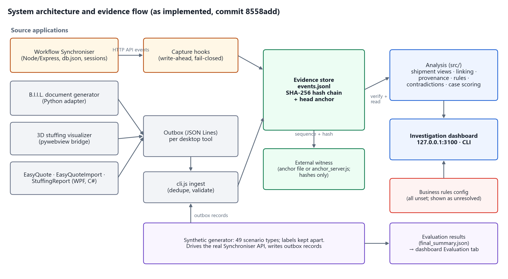
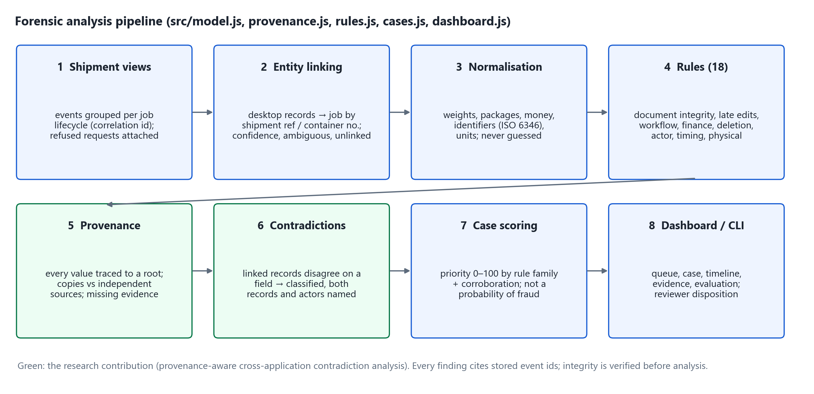
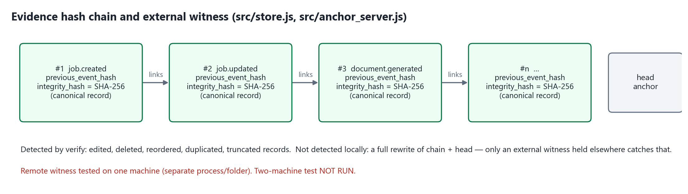
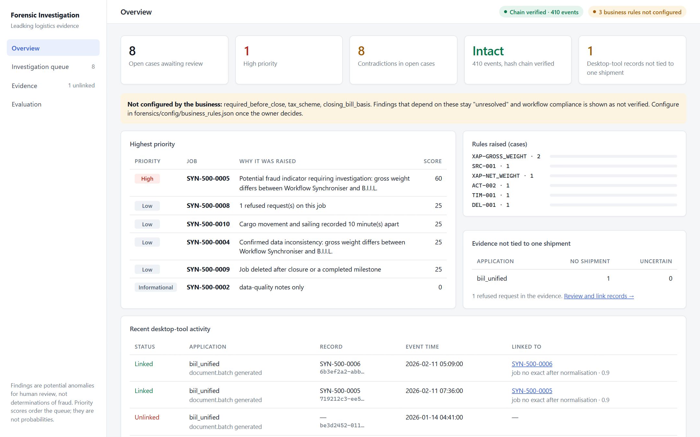
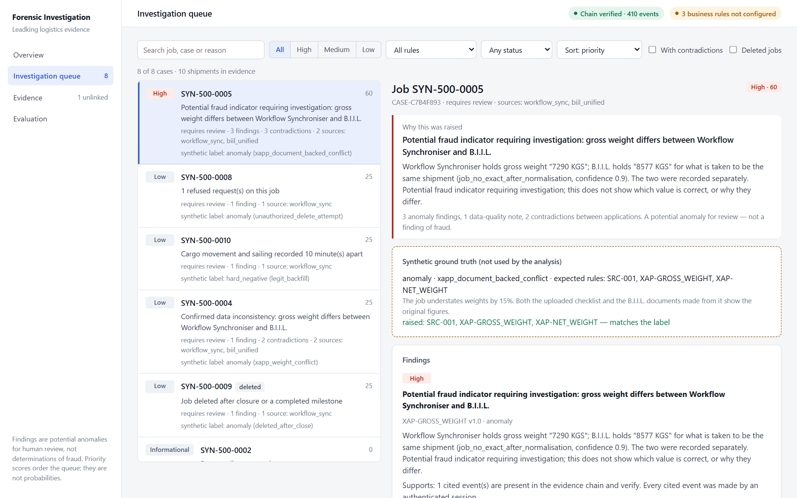
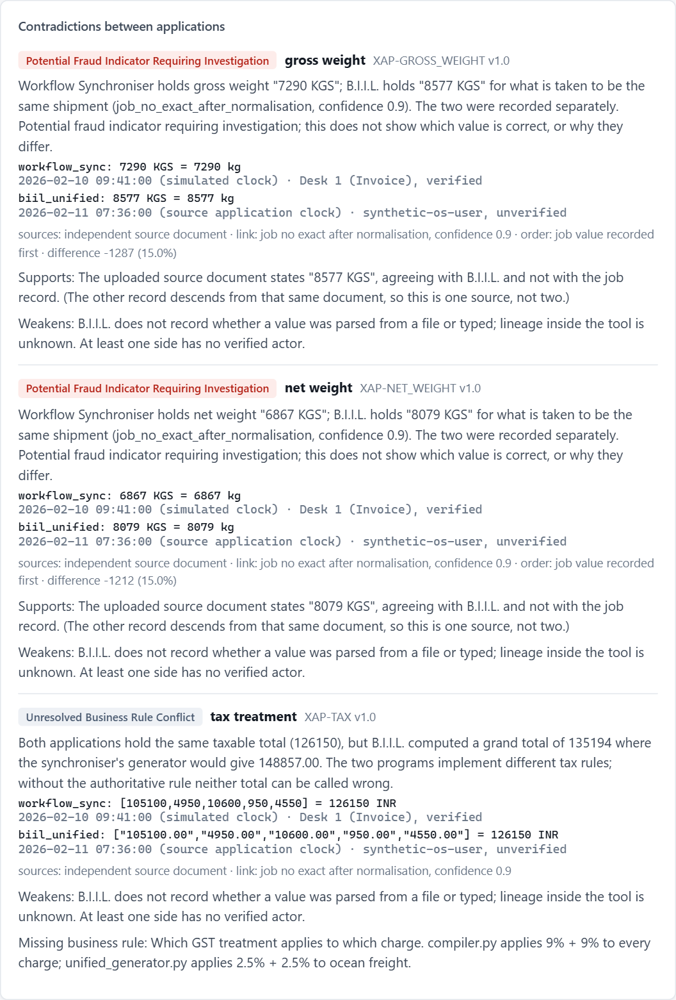
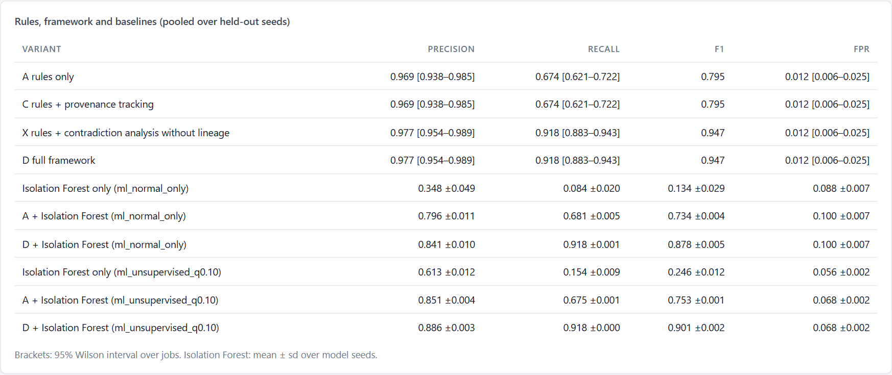
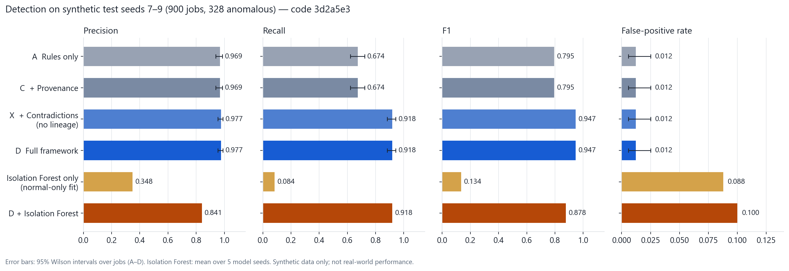

# A Forensic Analytics Framework for Detecting Fraud and Operational Anomalies in Integrated Logistics Management Systems

A forensic evidence and analysis layer built **around** the existing Leadking Logistics applications. It records operational activity as tamper-evident evidence, links records from different tools to the same shipment, and detects anomalies with deterministic rules and cross-application contradiction analysis. Every value is traced to its source, and the resulting cases are ranked in a local investigator dashboard.

> Academic prototype: Forensic Analytics (CSE4074), Fall 2026–27, Vellore Institute of Technology, Chennai.
> The operational applications (Workflow Synchroniser, B.I.I.L., 3D Stuffing Visualizer, EasyQuote, EasyQuoteImport, StuffingReport) pre-date this project and are not part of its contribution. The project adds the code under [`forensics/`](forensics/) and small capture hooks in those applications ([`docs/patches/`](docs/patches/)).
> **All evaluation results are on synthetic data.** They show that the implementation meets its specification; they do not establish real-world fraud-detection effectiveness.

---

## Key capabilities

- **Tamper-evident evidence store.** Append-only JSON Lines with a SHA-256 hash chain, a local head anchor, and an optional external witness.
- **Fail-closed capture in the Workflow Synchroniser.** A change is refused with HTTP 503 if its pre-change evidence record cannot be written.
- **Desktop-tool ingestion.** The desktop tools write records to an outbox; ingestion validates and de-duplicates them.
- **Entity linking.** Desktop-tool records are tied to jobs with a stated method and confidence. Ambiguous or unattributable records are never used as evidence against a shipment.
- **18 deterministic rules** and **cross-application contradiction analysis**.
- **Provenance (lineage).** Each value is traced to its source, so copies of one statement are not counted as independent agreement.
- **Case prioritisation (0–100).** Not a probability of fraud.
- **Investigator dashboard** (127.0.0.1 only) and a CLI.
- **Reproducible synthetic evaluation** against rules-only and Isolation Forest baselines.

## Problem statement

One shipment is handled by several separate tools that share no common key. In the original Synchroniser, editing a job overwrites the previous values. Its history log keeps only a free-text message and an unauthenticated, client-supplied user name, with no old or new values, and deleting a job erases that log.

Weights, charges, package counts and container numbers can therefore differ between tools without being noticed. Agreement between documents can also mislead, because several records may all be copies of one false source. An investigator needs three things:

- a record that cannot be quietly altered;
- a way to compare the tools' records for the same shipment;
- an honest statement of what that evidence does and does not prove.

## Research contribution

**Provenance-aware cross-application contradiction analysis and incident reconstruction:**

- detecting fields on which linked records from different applications disagree, and classifying each disagreement;
- stating whether agreeing records are genuinely independent or copies of one source;
- reconstructing a shipment's timeline across applications from verified evidence.

No novelty claim is made beyond this; no literature review is included in the repository.

## Architecture



## Eight-stage analysis pipeline



| # | Stage | Implementation |
|---|---|---|
| 1 | Shipment views: events grouped per job lifecycle; refused requests attached | `forensics/src/model.js` `buildViews` |
| 2 | Entity linking: desktop-tool records → job by shipment reference or container number | `forensics/src/model.js` `linkExternal` |
| 3 | Normalisation: units, money, identifiers (ISO 6346 check digits); unparseable values marked *not comparable*, never guessed | `forensics/src/normalize.js` |
| 4 | 18 deterministic rules | `forensics/src/rules.js` `RULES`, plus `IDN-002` |
| 5 | Provenance: lineage roots, corroboration, missing independent evidence | `forensics/src/provenance.js` `buildProvenance` |
| 6 | Contradiction analysis (XAP-*) | `forensics/src/provenance.js` `contradictionFindings` |
| 7 | Case scoring | `forensics/src/cases.js` `score` |
| 8 | Dashboard / CLI | `forensics/src/dashboard.js`, `forensics/cli.js` |

`forensics/src/cases.js` `analyze()` runs stages 1–7 on records read from the evidence store only.

## Evidence integrity



### Hash chain

- **Linking.** Each record stores `previous_event_hash` and its own `integrity_hash`: SHA-256 over a canonical form of the record (`forensics/src/store.js`).
- **Verification.** `node cli.js verify` checks the whole chain. Detection of edited, deleted, reordered, duplicated and truncated records is covered by automated tests. An inserted record breaks the sequence and hash links; that case is implemented but has no dedicated test.
- **Known limit, demonstrated by a test.** Someone who rewrites both the chain and the head anchor passes local verification.

### External witness

- **What it is.** An anchor file, or a remote witness (`forensics/src/anchor_server.js`) that stores only store ids, sequence numbers and hashes.
- **What it guarantees.** It refuses to change an entry it already holds, records any re-anchoring attempt as a conflict, and only accepts store ids on its allowlist.
- **Testing status.** Tested on one machine (separate process and folder). **The two-machine test has not been run.**

### Capture

- **Workflow Synchroniser.** A mandatory pre-change ("requested") event is written before each change. If it cannot be written, the change is refused with HTTP 503 (fail-closed default). Completion events are written best-effort; an operation without one is reported as an evidence gap.
- **Logins, reads and uploads** are captured best-effort.

## Application integration

| Application | Ingestion | Linking | Value comparison |
|---|---|---|---|
| Workflow Synchroniser | Yes (capture hooks) | Internal job views | Full |
| B.I.I.L. (`unified_generator.py`) | Yes (Python outbox adapter) | Yes | Yes |
| 3D Stuffing Visualizer | Yes (pywebview bridge) | Yes | Yes (packing runs) |
| StuffingReport | Yes (WPF outbox) | Yes | Yes |
| EasyQuote / EasyQuoteImport | Yes (WPF outbox) | Only if a shipment reference is entered | **No** |
| Legacy B.I.I.L. `document_generator.py` | No | No | No |

## Detection methodology

- **Deterministic rules.** These check one shipment's own evidence: late edits, closures, deletions, actor mismatches and so on. Each finding cites stored event ids.
- **Cross-application contradiction analysis.** Linked records that disagree on a field are compared. The fields are gross/net weight, packages, invoice number, shipping bill number, container numbers, taxable total, job number, timing and tax treatment. Each disagreement is classified as one of:
  - confirmed data inconsistency;
  - potential fraud indicator requiring investigation;
  - suspected operational anomaly;
  - insufficient evidence;
  - unresolved business-rule conflict.
- **Provenance and lineage.** Every value is traced to a root: an uploaded document, a manual entry, or another application. Records sharing a root are copies; a value with one root is reported as *needs an independent source*. Lineage changes what the investigator is told, not which jobs are flagged.
- **Case scoring.** Ranks the review queue (see below).
- **Isolation Forest.** Used only as a baseline in the evaluation (`forensics/evaluation/ml_baseline.py`). It is not part of the detection pipeline or the dashboard.

## Detection rules (18)

From [`forensics/src/rules.js`](forensics/src/rules.js):

| Rule | Family | Fires when |
|---|---|---|
| GEN-001 | document_integrity | Output-affecting data changed after documents were generated, and no later generation succeeded |
| GEN-002 | late_modification | Output-affecting data edited after a milestone that normally fixes the shipment record |
| GEN-003 | regeneration | Unusually many document generations for one shipment |
| WGT-001 | quantity_consistency | Header gross/net weight and package count differ from the container totals |
| FIN-001 | financial_consistency | Closing bill figures cannot be explained from the stored charges |
| WFL-001 | workflow | Job closed while other workflow steps were still pending |
| WFL-002 | workflow | Repeated reversal of completed workflow steps |
| WFL-003 | workflow | A large share of workflow steps marked not applicable |
| DEF-001 | placeholder_values | Placeholder charges inserted by the application are still billed |
| IDN-001 | identifier | Container check-digit errors, identifiers missing at closure, job number changed after creation |
| IDN-002 | identifier | The same container number on several open jobs |
| SRC-001 | source_consistency | Values stored at creation differ from values extracted from the uploaded source document |
| DEL-001 | deletion | Job deleted after it was closed or had passed a milestone |
| ACT-001 | actor | The actor named in a request does not match the authenticated session |
| ACT-002 | access_control | A privileged operation was attempted by an account not allowed to perform it, and refused |
| TIM-001 | timing | "Cargo Movement" and "Sailing Completed" recorded less than 120 minutes apart (configurable domain assumption) |
| PCK-001 | physical_feasibility | A linked packing run left cargo unplaced |
| EVD-001 | evidence_gap | Evidence for the shipment is incomplete (data-quality note, not scored) |

Rationale, tolerances and known false positives: [`docs/DETECTION_RULES.md`](docs/DETECTION_RULES.md).

## Case scoring

Implemented in `forensics/src/cases.js` (`SCORING`, `score`):

```
Score = min(100, round((Σ adjusted family weights + corroboration bonus) × evidence factor))
```

- **Family weight.** The highest severity weight among a rule family's anomaly findings: low 10, medium 25, high 40. A finding that rests only on an ambiguous cross-application link counts ×0.5. Contradiction findings form the family `cross_application`.
- **Corroboration bonus.** +10 when two rule families have anomaly findings, +20 for three or more. It counts **rule families**, not independent provenance sources.
- **Evidence factor.** 0.8 if an operation has no completion event or the job has no origin event; otherwise 1.
- **Bands.** High ≥ 60, medium ≥ 30, low ≥ 1, informational 0.

This is an **investigation-priority score** that orders the review queue. It is not calibrated and is **not a probability of fraud**.

## Dashboard

The dashboard runs locally only. It binds to `127.0.0.1` with no login, so anyone on that machine can read it.

| Tab or panel | What it shows |
|---|---|
| Overview | chain status, business-rule status, open cases, rules raised, evidence not tied to a shipment |
| Investigation queue | filters (text, priority, rule, status, contradictions, deleted jobs) |
| Case details | findings, contradictions between applications, where each value comes from, missing independent evidence, cross-application timeline |
| Review outcome | reviewer assessments, recorded only when started with `FORENSIC_REVIEW_TOKEN` |
| Evidence | integrity and link status of every desktop-tool record |
| Evaluation | the metrics below |

Screenshots (synthetic demo data, job numbers `SYN-500-…`):

| Overview | Case details |
|---|---|
|  |  |

| Contradiction between applications | Evaluation tab |
|---|---|
|  |  |

## Technology stack

- **Forensic layer:** Node.js (ES modules, standard library only at runtime).
- **Evaluation:** Python with scikit-learn and numpy for the Isolation Forest baseline.
- **Workflow Synchroniser:** Node.js / Express, bcryptjs, multer.
- **Document generation:** Python with openpyxl and pdfplumber.
- **Desktop tools:** C# WPF (.NET) for EasyQuote, EasyQuoteImport and StuffingReport; pywebview / Three.js for the 3D visualizer.
- **Browser tests:** playwright-core driving the installed Microsoft Edge.

## Repository structure

```
forensics/                 forensic layer (this project)
  src/                     store, capture, ingest, model, normalize, rules, provenance, cases, dashboard, anchor_server, business_rules
  cli.js                   command-line interface
  public/index.html        dashboard UI
  config/business_rules.json   business rules (all unset)
  adapters/                Python outbox adapter
  synthetic/               scenario generator (labels kept apart)
  evaluation/              evaluate.js, ml_baseline.py, summarize.js, results/
  e2e/                     demo.js, run_e2e.js, GUI drivers
  test/                    automated tests
docs/                      design, security, evaluation and audit documents; patches to the original applications
Workflow syncroniser/      operational web application (pre-existing; capture hooks added)
B,I,I,L/  3D_stuffing_visualizer/  EasyQuote/   operational tools (pre-existing; outbox adapters added)
e2e/                       convenience entry points that forward to forensics/e2e
```

## Prerequisites

- Windows (the desktop tools and helper scripts target Windows).
- Node.js 20 or later.
- Python 3.11 or later (document generation, adapters, evaluation).
- Optional: .NET SDK to rebuild the WPF tools; Microsoft Edge for the browser tests.

## Installation

```
cd "Workflow syncroniser"
npm install
cd ..\forensics
npm install
setup_env.cmd
```

- `npm install` in `Workflow syncroniser/` installs the operational application's dependencies.
- `npm install` in `forensics/` installs `playwright-core`, needed only for the browser tests.
- `setup_env.cmd` creates `forensics\.venv` from `requirements.txt`. The Synchroniser and the tests find it automatically; `SYNC_PYTHON` overrides it.

## Configuration

Main environment variables (full list: [`docs/RUNTIME_SETUP.md`](docs/RUNTIME_SETUP.md)):

| Variable | Purpose |
|---|---|
| `SYNC_ADMIN_PASSWORD` | One-time bootstrap of the first administrator when no accounts exist; there are no default accounts |
| `SYNC_TLS_CERT`, `SYNC_TLS_KEY` | Serve the Synchroniser over HTTPS. Without them it runs plain HTTP and warns at start-up |
| `FORENSIC_DIR` | Evidence store folder (default `forensics/data`) |
| `FORENSIC_FAIL_MODE` | `closed` by default; `open` must be set explicitly and is recorded |
| `FORENSIC_ANCHOR_FILE` | Local external anchor file |
| `FORENSIC_ANCHOR_URL`, `FORENSIC_ANCHOR_TOKEN`, `FORENSIC_ANCHOR_STORE_ID` | Remote witness |
| `FORENSIC_REVIEW_TOKEN` | Enables recording reviewer assessments in the dashboard |
| `FORENSIC_BUSINESS_RULES` | Alternative business-rules file |

**Business rules.** [`forensics/config/business_rules.json`](forensics/config/business_rules.json) leaves the mandatory workflow steps, the tax scheme and the closing-bill basis unset (`null`). They have not been decided by the business owner. While unset, results that depend on them are reported as *unresolved*, and the dashboard and CLI say so. An invalid file is refused rather than treated as unset ([`docs/DECISIONS_AND_OPEN_REQUIREMENTS.md`](docs/DECISIONS_AND_OPEN_REQUIREMENTS.md)).

## Running

### Demonstration (synthetic data, about 30 seconds)

```
node e2e/demo.js --serve
```

Run this from the repository root, or use `cd forensics && npm run demo`. It runs ten synthetic shipments through the real Synchroniser and desktop-tool records, analyses them, and serves the dashboard at http://127.0.0.1:3100. Add `--port <n>` if that port is taken.

Walkthrough: [`docs/DASHBOARD_AND_DEMO.md`](docs/DASHBOARD_AND_DEMO.md).

### Operational use (local)

```
cd "Workflow syncroniser"
set SYNC_ADMIN_PASSWORD=<strong password, first start only>
node server.js
```

```
cd forensics
node cli.js ingest
node cli.js verify
node cli.js anchor
node cli.js cases
node cli.js case CASE-XXXXXXXX
node src/dashboard.js --dir <evidence folder>
```

What each command does:
- `node server.js`: starts the Synchroniser; evidence is captured to `FORENSIC_DIR`.
- `cli.js ingest`: imports desktop-tool outbox records.
- `cli.js verify`: checks chain integrity, and the witness if one is configured.
- `cli.js anchor`: pushes pending hashes to a remote witness.
- `cli.js cases`: shows the review queue.
- `cli.js case CASE-XXXXXXXX`: shows one case with its findings and timeline.
- `src/dashboard.js --dir <evidence folder>`: serves the dashboard on 127.0.0.1:3100.

Other CLI commands: `head`, `reconcile`, `timeline`, `artifacts`, `evidence`, `link`, `features`, `analyze` (see the header of `forensics/cli.js`).

### Remote witness (separate trust domain)

Run this on the witness machine. The procedure is in [`docs/EXTERNAL_ANCHOR.md`](docs/EXTERNAL_ANCHOR.md).

```
set FORENSIC_ANCHOR_TOKEN=<long random secret>
node forensics/src/anchor_server.js --dir <witness folder> --port 3200 --host <private address> --stores <store id>
```

## Running tests

```
cd forensics
npm test
node e2e/run_e2e.js
```

- `npm test` runs the automated tests. The 4 desktop-window tests run only with `FORENSIC_GUI_TESTS=1`.
- `node e2e/run_e2e.js` is the 28-step end-to-end check on a disposable instance.

The last recorded runs, both on 2026-10-29, are in [`docs/TESTING_GUIDE.md`](docs/TESTING_GUIDE.md):
- `npm test`: 195 tests, 191 passed, 0 failed, 4 skipped;
- end-to-end: 28 of 28 steps.

## Evaluation results (synthetic)

Primary test set: seeds 7–9, 900 jobs, generated at commit `7ebf118` and evaluated at `3d2a5e3`. Of these, 328 are anomalous and 572 negative: 245 normal, 303 hard negatives (legitimate look-alikes) and 24 data-quality cases.
- Tuning was done on a separate set, `tune-11`.
- Isolation Forest was fitted on `train-201` (normal behaviour only) and, in its unsupervised protocol, on `tune-11`.
- The unit is one labelled job. Labels are never read by the analysis.

| Variant | TP | FP | FN | TN | Precision [95% CI] | Recall [95% CI] | F1 | FPR |
|---|---|---|---|---|---|---|---|---|
| A — rules only | 221 | 7 | 107 | 565 | 0.969 [0.938, 0.985] | 0.674 [0.621, 0.722] | 0.795 | 0.012 |
| C — + provenance | 221 | 7 | 107 | 565 | 0.969 | 0.674 | 0.795 | 0.012 |
| X — + contradictions, no lineage | 301 | 7 | 27 | 565 | 0.977 | 0.918 | 0.947 | 0.012 |
| **D — full framework** | **301** | **7** | **27** | **565** | **0.977 [0.954, 0.989]** | **0.918 [0.883, 0.943]** | **0.947** | **0.012** |
| Isolation Forest alone (normal-only / unsupervised fit) | | | | | 0.348 / 0.613 | 0.084 / 0.154 | 0.134 / 0.246 | 0.088 / 0.056 |
| D + Isolation Forest (normal-only / unsupervised fit) | | | | | 0.841 / 0.886 | 0.918 / 0.918 | 0.878 / 0.901 | 0.100 / 0.068 |



- **Recall** rises by **24.4 percentage points** (0.674 → 0.918) with no added false positives. The gain comes from contradiction analysis; lineage does not change detection.
- **Lineage** changes attribution. With lineage, 61/61 lineage expectations are met; without it, 23/61. Without lineage, every agreement between copies is counted as independent.
- **Unseen families** (`unseen-301`): 150 jobs from 10 families pre-registered before generation (5 anomaly families, 5 negative controls), 58 anomalous and 92 negative.
  - Full framework: 58/58 anomalies flagged, 0/92 negatives flagged.
  - Rules only: 14/58 anomalies flagged.
- **False positives:** all 7 are back-entered jobs flagged by TIM-001, a documented known false positive.
- **Misses:** all 27 are falsifications repeated consistently (18) or copied from one source (9). These cannot be detected from internal evidence; the framework reports them as resting on a single source.

Sources and reproduction:
- Result files: `forensics/evaluation/results/final_summary.json` and `unseen.json`.
- Full report and reproduction commands: [`docs/FINAL_EVALUATION_REPORT.md`](docs/FINAL_EVALUATION_REPORT.md) §0. Generation takes about 20 minutes.
- The `npm run evaluate` script still evaluates the earlier seeds 4–6 set; use the report's commands for seeds 7–9.
- Historical results are kept under `forensics/evaluation/results/historical-*`.

## Limitations

- **Synthetic data only.** Rules, scenarios, labels and unseen families share one author, so the results show specification conformance, not real-world accuracy. There is no real or audited data and no reviewer study.
- **Known false positive (TIM-001)** for back-entered jobs. Consistent falsification from one source is undetectable without an independent source of truth.
- **Priority scores are not calibrated.**
- **Business rules unresolved:** tax treatment, mandatory workflow steps and closing-bill basis.
- **EasyQuote quotation analysis** (rates and values) is not implemented; quotations are only ingested and, with a shipment reference, linked.
- **Remote witness** validated on one machine only; HTTPS is optional and off by default; no multi-factor authentication; the admin password reset is API-only.

## Future work

- Validate on labelled real or independently audited shipments.
- Use independent authors for scenarios and labels.
- Complete the two-machine remote-witness test.
- Run a reviewer study measuring investigation time and agreement.
- Resolve the business-rule definitions with the domain owners.
- Implement quotation-rate analysis.

## Security and data privacy

- Use synthetic data for demonstrations. Keep the dashboard on localhost and protect evidence folders like the operational database. There are no default accounts.
- **This repository is not safe to publish.**
  - Its Git history and sample documents contain unverified, potentially real business identifiers and contact details.
  - The source archive is not clean either: generator defaults contain third-party contact details.
  - A clean README does not change this.

  See [`docs/DATA_AND_REPOSITORY_AUDIT.md`](docs/DATA_AND_REPOSITORY_AUDIT.md) before sharing anything.
- Security model and residual weaknesses: [`docs/SECURITY_AND_LIMITATIONS.md`](docs/SECURITY_AND_LIMITATIONS.md).

## Project context

Forensic Analytics (CSE4074), Fall 2026–27, Vellore Institute of Technology, Chennai, under Dr. S. Johanan Joysingh. The operational Leadking Logistics applications were provided as the system under study; this project contributes the forensic layer and its evaluation.
