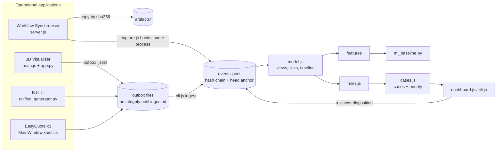

# Repository Architecture

Static reverse-engineering detail is in [FORENSIC_REVERSE_ENGINEERING_REPORT.md](../FORENSIC_REVERSE_ENGINEERING_REPORT.md). This file records what the implementation work confirmed, and how the forensic layer sits beside the existing applications.

Labels: **S** = confirmed by source inspection, **R** = confirmed by runtime test, **I** = inferred, **U** = unverified.

## 1. Components

| Component | Path | Runtime | Forensic status |
|---|---|---|---|
| Workflow Synchroniser | `Workflow syncroniser/` | Node/Express + `db.json` + Python subprocess | **Live source.** Every state-changing route emits evidence (R) |
| 3D Load & Stuffing Visualizer | `3D_stuffing_visualizer/` | Browser bundle in a pywebview window | Adapter added; Python side and payload tested, GUI path not exercised (see §4) |
| B.I.I.L. | `B,I,I,L/unified_generator.py` | Tkinter desktop | Adapter added; real `generate_all()` run tested headlessly (R) |
| EasyQuote, EasyQuoteImport, StuffingReport | `EasyQuote/` | WPF desktop | Adapter added; all three projects compile (R); export path not executed (U) |
| Forensic layer | `forensics/` | Node (no dependencies) + one Python script for the ML baseline | New |

The four applications are still **not** one integrated system. They share no database or identifier. What now exists is a common evidence format and a store that the synchroniser writes to directly and the desktop tools reach through outbox files.

`Workflow syncroniser/BIIL/` remains an unused byte-identical copy of B.I.I.L. and is not instrumented. `B,I,I,L/document_generator.py` (legacy, not part of the built executable) is not instrumented.

## 2. Synchroniser data flow as confirmed

| Path | Confirmed behaviour | Label |
|---|---|---|
| `POST /api/jobs` | Runs `compiler.py compile` first, then `createJob`. A compile failure is swallowed and the job is saved anyway | R |
| `PUT /api/jobs/:id` | Compiles with the **new** data, then `updateJob` replaces header fields and all child rows | R |
| `PUT …/workflow/:stepId` | Mutates the step row **in place**; reopening "Job Closed" blanks the four closing fields | R |
| `DELETE /api/jobs/:id` | Removes the job, children and `history_logs` rows | R |
| `POST /api/parse-checklist` | Fails with ENOENT until `uploads/` exists (multer does not create it) | R |
| `/uploads/<file>` | Not served; falls through to `index.html` | R |
| Actor names | Any string sent as `user`/`creator` is stored | R |
| `requireAdmin` | Passes when the caller sends `adminUsername=admin` | R |
| Generated `.xlsx` | Byte content differs between two runs on identical input (save time embedded) | R |
| Start-up | `db.js` seeds users and runs migrations at import time, outside any request | S |
| Row objects | `getJobById()` returns references to live rows, so a "before" snapshot must be deep-copied | R (found by a failing test) |
| Database ids | `max(id)+1`; an id is reused after the newest row is deleted | R |

State-mutating functions in `db.js`: `createJob`, `updateJob`, `deleteJob`, `toggleWorkflowStep`, `toggleDocumentStatus`, `updateDocumentUrls` (exported, never called), `createUser`, `deleteUser`, plus the start-up block. `server.js` is the only caller.

## 3. Forensic layer layout

```
forensics/
  src/store.js        append-only hash-chained JSONL store, verifier, query
  src/diff.js         field-level job diff on business keys; state hash
  src/capture.js      hooks called by the synchroniser's server.js
  src/ingest.js       outbox -> chain for the desktop tools
  src/normalize.js    weights, packages, number+date strings, ISO 6346, money
  src/model.js        shipment views, timeline reconstruction, entity links, reconciliation
  src/rules.js        16 detection rules + configuration
  src/cases.js        case assembly, priority score, behavioural features, dispositions
  src/dashboard.js    read-only HTTP dashboard (localhost)
  public/index.html   dashboard page
  cli.js              verify / reconcile / cases / case / timeline / ingest / features / analyze
  adapters/forensic_outbox.py   outbox writer for the Python tools
  synthetic/          scenario catalogue and dataset generator
  evaluation/         rule evaluation (Node) and Isolation Forest baseline (Python)
  test/               automated tests
  data/               live evidence (created at first run; not for version control)
  datasets/           generated synthetic datasets
EasyQuote/ForensicOutbox.cs     outbox writer for the three WPF tools
3D_stuffing_visualizer/src/forensicPayload.js   packing-run evidence summary
```



## 4. What was changed in existing files

Full diffs are in [docs/patches/](patches/). Summary in [INTEGRATION_POINTS.md](INTEGRATION_POINTS.md).

| File | Change |
|---|---|
| `Workflow syncroniser/db.js` | `SYNC_DB_PATH` override; exported `startupInfo` |
| `Workflow syncroniser/server.js` | Capture hooks in every write route; configurable folders and Python path; `uploads/` created at start; evidence-store failures return 503 |
| `Workflow syncroniser/public/js/app.js` | The two delete calls send the logged-in user's name in `X-Claimed-User` |
| `3D_stuffing_visualizer/src/packing.js` | `unplacedReason` on unplaced items (`payload_exceeded`, `no_space`, `no_stable_position`) |
| `3D_stuffing_visualizer/src/main.js`, `projectionExporter.js`, `index.html`, `app.py` | Optional shipment-reference input; packing-run and report-saved events through the pywebview bridge |
| `B,I,I,L/unified_generator.py` | One evidence snapshot per `generate_all()` run |
| `EasyQuote/**/MainWindow.xaml.cs`, two `.csproj` | `RecordExport()` after each export or clipboard copy |

`3D_stuffing_visualizer/dist/` was rebuilt with `npm run build` so the desktop wrapper serves the instrumented bundle.
